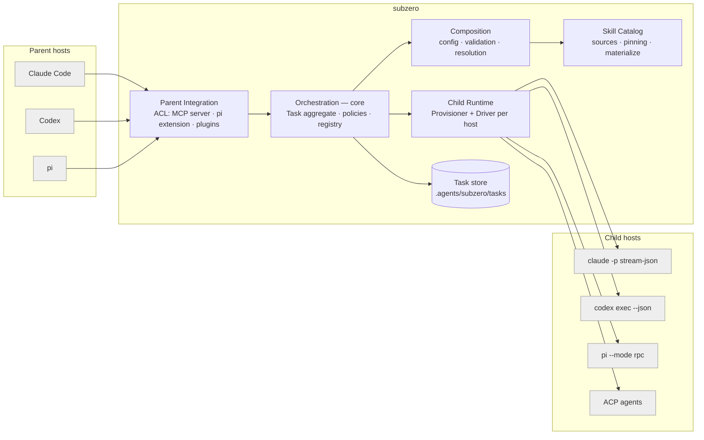
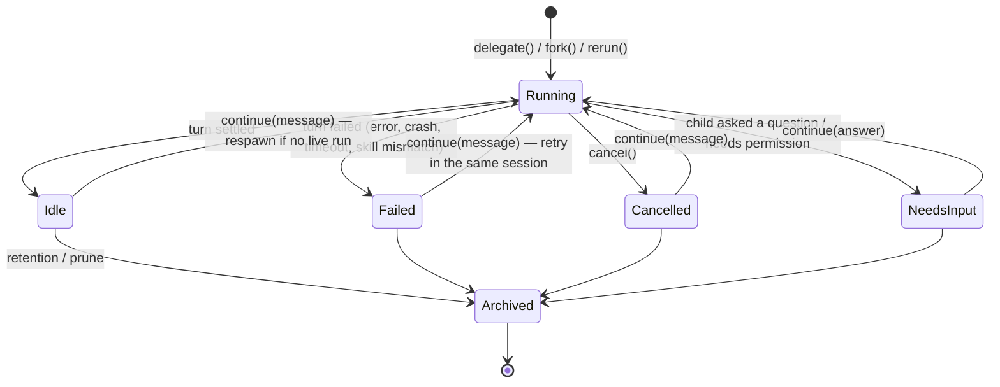
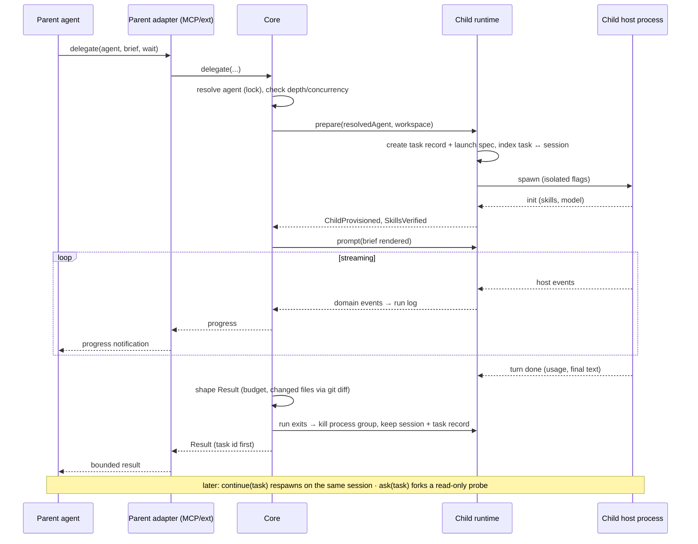

# subzero: domain design

Status: draft · 2026-10-30 · builds on [problem.md](problem.md); integration facts are in
[feasibility.md](feasibility.md); open items are in [decisions.md](decisions.md).

## 1. Ubiquitous language

| Term | Meaning |
|---|---|
| **Parent** | The coding agent the user is talking to (Claude Code, Codex, pi). It delegates. |
| **Child** | A coding-agent process that subzero starts to do one delegation. |
| **Host** | The kind of agent runtime: `claude`, `codex`, `pi`, `acp:<name>`. Parents and children both have a host. |
| **Agent definition** | A named entry in `.agents/subzero.yaml`: description, skills, host, model, reasoning and policies. Like a compose *service*. |
| **Skill** | An Agent Skills folder (`SKILL.md` plus resources). Referred to by name; resolved from a **skill source**. |
| **Resolved agent** | An agent definition with every reference resolved: skill folders pinned (content hash), model mapped to the host, defaults applied. Immutable. Like a compose *image*. |
| **Delegation** | One request from a parent: *agent + brief*. It creates one **task**. |
| **Brief** | The self-contained task text plus optional context (file paths, constraints, expected output) that the parent sends. The child sees nothing else from the parent. |
| **Task** | The unit the parent holds. It has a stable **task id** (`sz-7f3k2q`) and is tied to exactly **one child session** for its whole life. It is continued, asked about, forked and rerun by that id. Like a compose *container*, which survives restarts. |
| **Child session** | The host's own conversation for a task (the pi session file). It holds the full transcript and never crosses into the parent. |
| **Run** | One child **process** working on a task. A task can have many runs: the process exits after a turn, and a later `continue` **respawns** it on the same session. |
| **Turn** | One input to the task (the brief, a follow-up, or an answer), processed until the child settles. Every turn returns exactly one bounded **result**. |
| **Report** | A digest of everything a task did, built from its events without an LLM: turns, files read and changed, commands, skills used, errors, usage. |
| **Probe** | A read-only fork of a task's session, used to answer a question about the work (`ask`) without touching the main session. |
| **Workspace** | The filesystem view the child gets: working directory, extra dirs, and the **skill overlay** (a directory holding *only* the declared skills). The host's own home stays the user's real one: same login, same session storage. |
| **Task record** | `.agents/subzero/tasks/<task-id>/`: the frozen agent, the **launch spec** (exact argv, cwd, host version), the id mapping to the child session and the parent session, runs, turns, results, report and event log. Enough to continue, respawn, fork, rerun, ask, inspect or attach later. |
| **Result** | What goes back to the parent: status, a summary bounded by the result budget, optional structured output, changed files, usage and cost. |
| **Event log** | The full normalized event stream of a task across all its runs, stored on disk. It is never sent to the parent. |

## 2. Bounded contexts



| Context | Responsibility | Owns | Relationship |
|---|---|---|---|
| **Composition** | Parse, merge and validate `.agents/subzero.yaml` and skill manifests; produce `ResolvedAgent` | AgentDefinition, Defaults, Profiles | Upstream of Orchestration (published language: `ResolvedAgent`) |
| **Skill Catalog** | Resolve skill refs (local path, git, npm), pin content hashes, check portability, materialize into a host-specific layout | Skill, SkillSource, SkillLock | Upstream of Composition and Child Runtime |
| **Orchestration (core)** | Task lifecycle, runs and turns, state machine, policies (timeouts, budgets, concurrency, depth), result shaping, reports, probes | **Task** (aggregate root), Run, Turn, Result, Report, Policy | Core domain |
| **Parent Integration** | Turn host tool calls and skills into domain commands and back. One adapter per parent host. | Tool schemas, proxy skills, progress mapping | Anti-corruption layer (ACL) in front of the core |
| **Child Runtime** | Provision an isolated child for a host and drive it. Normalize host events into domain events. | Provisioner, Driver, HostCapabilities | ACL behind the core; one adapter per child host |
| **Task store** | Persist task records, the id index, event logs, results and reports | TaskRecord, TaskIndex | Supporting |

The core never imports host-specific types. Both adapter layers depend on the core's ports
(hexagonal architecture):

```
ParentPort (driving):  delegate · continue · ask · tasks · await · cancel
ChildPort  (driven):   Provisioner.prepare(ResolvedAgent, WorkspaceRequest) -> PreparedChild
                       Driver.start(PreparedChild) -> ChildHandle
                       Driver.start(PreparedChild, { resume?: SessionRef, fork?: {SessionRef, at?} })
                       ChildHandle.prompt(text) · .cancel() · .events(): AsyncIterable<ChildEvent> · .dispose()
                       Driver.capabilities(): HostCapabilities
```

### Key design insight: separate provisioning from transport

Every child host needs two separate things:

1. **Provisioning** (always host-specific): how to make *only* these skills visible, set model and
   reasoning, apply sandbox and permissions, and keep user and repo config out. Examples are
   `pi --no-skills --skill …`, the real `CODEX_HOME` with `--ignore-user-config` and `-c` skill
   disabling, and `claude --disable-slash-commands` plus the declared skills inlined (§6.1, D18).
2. **Transport** (can be shared): how to send a prompt and receive events. Options are native JSONL
   (`claude -p --output-format stream-json`, `codex exec --json`, `pi --mode rpc`) or **ACP**.

ACP standardizes transport (sessions, prompts, updates, permission requests, cancel). It has **no
skills concept**, and its client-provided system prompt (RFD #1237) is still unstable. So "ACP or CLI"
is not an either/or choice. A child adapter is `Provisioner × Transport`. Provisioners are written per
host, and the ACP transport is a reusable driver that can be paired with any provisioner whose host has
an ACP adapter.

## 3. Core domain model

### 3.1 Aggregate: `Task` (with Runs and Turns)

```
Task                      the aggregate root: the id the parent holds
  id: TaskId              "sz-7f3k2q": short, stable, easy to type. Also used as the child session id
                          where the host accepts one (pi). Otherwise (claude needs a UUID, codex
                          assigns its own) the host's id is stored in `child.sessionId` and the index.
  agent: ResolvedAgent    frozen at creation (+ agentHash); continuing never changes the skills
  origin: Origin          { parentHost, parentSessionId, toolUseId, depth }: who asked
  lineage: Lineage?       { forkedFrom?: {task, turn}, rerunOf?: task, probeOf?: task }
  child: ChildSessionRef  { host, sessionId, sessionFile, launch: LaunchSpec }
  runs:  Run[]            one per child process
  turns: Turn[]           one per input
  report: Report          rebuilt after every turn
  status: TaskStatus      running | idle | needs_input | failed | cancelled | archived

Run   { runId, pid, overrides{model?,thinking?}, startedAt, endedAt?,
        exit?: settled | crashed | killed | timed_out | parent_gone }
Turn  { turnId (1,2,3…), kind: brief | followup | answer, input, by: parent | user,
        runId, entries: {firstId, leafId}, result: Result, usage }
LaunchSpec { argv (without the prompt), cwd, envNames, hostVersion, skillPaths }
```

`entries` are the child session's own entry ids (pi entries have stable ids). They let subzero fork
"at turn 2" and read exactly the events of one turn.

Invariants:
- **One task ↔ one child session, for life.** Anything that needs a *new* session is a *new task* with
  `lineage` (fork, rerun, probe). This 1:1 mapping keeps "continue task X" unambiguous.
- **At most one live run per task**, enforced by a task lock. A `continue` that arrives while a turn is
  running is queued as the host's follow-up (pi `follow_up`), or rejected with `busy` if the parent asked
  for that.
- **Respawning is transparent.** If a task is idle and its process has exited, `continue` starts a new
  run with the *same* LaunchSpec plus the session file. The parent never sees the difference; only the
  task record gains a run.
- **The agent is frozen.** `continue` may override only model, thinking and deadlines, which are
  recorded on the Run. Different skills means a new task (`rerun` with another agent). If the YAML has
  changed since the task was created, `continue` keeps the frozen version and says so in the result.
- **Every turn returns exactly one bounded `Result`.** The core shapes it to `budget.maxResultTokens`.
  The transcript, tool output and skill content never cross into the parent.
- `depth ≤ policy.maxDepth`, which stops a child from recursively delegating through its own subzero.
- **When a run ends, the context ends with it; the task stays.** The process group is killed, so the
  skill content in the child's context is gone. The task record and child session are kept until
  `retention` expires, so the task can be continued, asked about, forked, rerun, inspected or attached.

### 3.2 Lifecycles

Task:



Failed and Cancelled are **not** final. The session still exists, so the parent or the user can continue
it ("you hit a timeout; carry on from where you stopped").

Run (one process):
`Pending` (waiting for a concurrency slot) → `Starting` (spawn, verify skills) → `Live` → `Exited(reason)`.
With `process: exit` (the default), the run exits once its turn settles. With `process: keep`, it stays
`Live` until the TTL runs out, so quick follow-ups skip the cold start. Either way the task becomes `Idle`.

### 3.3 Domain events

These are written to the run log and used for parent progress notifications:
`TaskCreated(lineage)`, `RunStarted(launch, overrides)`, `ChildProvisioned(model, reasoning applied)`,
`SkillsVerified`, `TurnStarted(kind)`,
`AgentMessage(delta|final)`, `ToolActivity(name, args summary, status)`, `FileRead(path)`,
`FileChanged(path)`, `SkillUsed(name)`, `InputRequested(question|permission)`, `TurnSettled(result)`,
`RunExited(reason)`, `TaskStatusChanged`, `TaskArchived`.
The **report** (§3.5) is a projection of these events.

Each driver maps its host's stream onto these events:

| Domain event | claude stream-json | codex exec --json | pi rpc/json | ACP |
|---|---|---|---|---|
| ChildProvisioned / SkillsVerified | `system/init` (lists `skills`, `plugins`, `mcp_servers`) | `thread.started` (no skill list, so check separately) | `session` header + `get_commands` | `initialize` + `session/new` |
| AgentMessage | `assistant` / partial messages | `item.*` agent_message | `message_update` text_delta | `session/update` agent_message_chunk |
| ToolActivity | `tool_use` / `tool_result` | `item.*` command_execution, mcp_tool_call | `tool_execution_*` | `tool_call` / `tool_call_update` |
| TurnSettled | `result` (`total_cost_usd`, `session_id`) | `turn.completed` (`usage`) | `agent_settled` (not `agent_end`) | `session/prompt` response `stopReason` |
| InputRequested | permission-prompt tool / denied | n/a in exec (policy only) | `extension_ui_request` | `session/request_permission` |

### 3.4 Value objects

- **ModelRef**: `provider/model` (e.g. `ollama/qwen3-coder`, `anthropic/claude-sonnet-5-5`). It is
  checked against the host's compatibility matrix when the definition is resolved, not at run time.
- **Reasoning**: `off | minimal | low | medium | high | xhigh | max`. Each host gets a mapping that may
  lose detail, and the core reports what it actually applied in `ChildProvisioned`. Examples: Claude has
  no `off` on 5.5 models, so `off` is clamped to `low`. Codex values depend on the model.
- **SkillRef**: `name` plus the source it resolves to, pinned in `subzero.lock` (path, git rev, sha256).
- **Brief**: `{ task, context?, files?[], expectedOutput?, outputSchema? }`.
- **Result** (one per turn): `{ task, turn, status, summary, structured?, changedFiles[],
  questions?[], usage{tokens,usd,duration}, next: [continue, ask, fork] }`. `status` is
  `completed | truncated | needs_input | failed | cancelled`. `needs_input` carries
  `input.kind: question | permission`, matching `InputRequested`. `failed` carries a `reason`:
  `skill_mismatch | timeout | crashed | error`. The task id always comes
  first, so it survives in the parent's history and after compaction.

### 3.5 Knowing what the child did, without its context

The parent gets only what it asks for, always bounded. The child's full context stays in the child
session.

| Level | What the parent gets | Size | How it's produced |
|---|---|---|---|
| **Result** | Final answer, status, changed files, task id | ≤ result budget (2k by default) | Automatically, every turn |
| **Report** | Turns with their inputs, files read and changed (diff stats), commands with exit codes, skills used, errors, usage | ≤ ~1k, or one turn | `tasks(task, detail: report)`. A projection of the event log, **no LLM call** |
| **Ask** | An answer to any question about the work ("why did you choose X?", "which tests did you run?", "show the function you changed") | ≤ result budget | `ask(task, question)`: a **probe** (below) |
| **Transcript** | Everything | never sent to the parent | For humans: `subzero show`, `subzero attach` |

**How `ask` works.** The child already holds the full context of its work, so it is the best analyst of
it. subzero forks the task's session into a **probe task** (`lineage.probeOf`) with a read-only tool set,
sends the question, and returns the bounded answer. The probe gets its own task id, so its Q&A is kept
for audit.
- The main session is untouched: later `continue` turns don't see the Q&A.
- The parent only pays for the answer.
- It costs one turn on the child's model. On a local model, the prompt cache may make this cheap.
- For pi: `--fork <session file> --session-id sz-<task>-q<n> --tools read,grep,find,ls`.

### 3.6 Identity mapping and storage

```
.agents/subzero/
  index.jsonl                 # one line per task (append-only, latest line wins):
                              #   task, agent, status, parentHost, parentSessionId, toolUseId,
                              #   childHost, childSessionId, sessionFile, lineage, createdAt, updatedAt
  tasks/<task-id>/
    task.json                 # aggregate snapshot: agent (frozen), launch spec, runs, turns, status
    events.jsonl              # domain events across all runs
    turns/<n>.json            # input + the exact Result the parent received
    report.md                 # current report (§3.5)
  sessions/                   # pi child session files, named after the task id
```

Lookups the index supports:
- **task → child session**: used by continue, respawn, fork, ask, attach.
- **child session → task**: used when the user finds a `subzero:*` session in pi's `/resume`.
- **parent session → tasks**: "what did my subagents do in this conversation?" Works after compaction
  and `/clear`, because the parent adapter records the parent session id; on Claude, through the
  SessionStart hook.
- **task → lineage**: forks, reruns and probes of a task.


## 4. Configuration (`.agents/subzero.yaml`)

It is modelled on compose: a top-level map of named agents, shared defaults, a skill source map,
override files, and `${ENV}` interpolation.

```yaml
version: 1

defaults:
  host: pi
  reasoning: medium
  workspace: shared          # shared | worktree  (where the child works)
  permissions: read-only     # read-only | workspace-write | full  (what it may do there; D8)
  timeout: { idle: 5m, wall: 30m }
  result: { max_tokens: 2000 }
  process: exit              # exit (kill when the task ends) | keep (stay alive for follow-ups, ttl)
  record: keep               # keep (host session + run record kept) | none (nothing written)
  retention: 30d

skills:                      # paths are relative to this file; bare names fall back to ./subzero/skills/<name>
  skill-a: ./subzero/skills/skill-a
  skill-b: git+https://github.com/acme/skills#path=skill-b&ref=v1.4.0

models:                      # optional named endpoints, referenced as <name>/<model>
  local:
    base_url: http://localhost:8000/v1
    api: openai-completions  # what the child host must speak
    api_key: ${LOCAL_API_KEY}
  tiers:                     # what skill manifests' `tier:<name>` hints resolve to, per host
    medium: { pi: local/qwen3-coder-30b, claude: anthropic/claude-sonnet-5-5 }
    large:  { claude: anthropic/claude-opus-5-5 }

agents:
  semanticizer:
    description: >           # REQUIRED - this is all the parent sees when routing
      Builds a semantic model of a module. Use for "what does X mean / how is Y modelled".
    skills: [skill-a, skill-b]
    host: pi                 # claude | codex | pi | acp:<agent-id> | native (parent's own subagent) | inline
    model: local/qwen3-coder-30b
    reasoning: high
    instructions: |          # appended to the child's system prompt
      Answer with a concise summary first, then details.
    tools: [read, grep, find, bash]   # host-neutral allow-list, mapped per host
    permissions: read-only   # read-only | workspace-write | full  (maps to host sandbox flags)
    delegates: []            # agents this child may delegate to (nested; D14, v0.1). Empty = no delegate tool
    result: { report_file: false }  # true: full output goes to a file; the result carries summary + path
    output:
      schema: ./schemas/semantic-model.json   # optional structured result
    expose:
      tool: true             # visible through the delegate tool
      proxy_skill: true      # also install a tiny proxy SKILL.md in the parent (see §5.2)
```

### 4.1 Where definitions come from: the workspace or the skill

An agent definition can come from two kinds of places, which are merged in layers.

1. **Workspace compose file.** It lives in `.agents/`, next to the `.agents/skills/` folder that
   agents already share:

   ```
   .agents/
     subzero.yaml          # team config, committed
     subzero.local.yaml    # personal overrides, gitignored
     subzero.lock          # pinned skills + host versions, committed
     skills/               # host-visible skills; subzero writes only proxy skills here for Codex/pi parents (§5.2)
     subzero/
       skills/             # subzero-managed skills, committed. NOT under .agents/skills (P19)
       index.jsonl         # task index (§3.6), gitignored
       tasks/              # task records, event logs, skill overlays (§3.6), gitignored
       sessions/           # pi child sessions, gitignored
   ```

   The user-level file is `~/.agents/subzero.yaml`, mirroring `~/.agents/skills`. It holds model
   endpoints, keys, tiers and policy. `subzero init` writes the `.gitignore` entries.
2. **Skill manifest.** A skill can ship its own recommended agent definition in
   `<skill>/agents/subzero.yaml`. Codex already uses `agents/openai.yaml` inside a skill folder the same
   way. This is how a skill author says "this skill should run as a sub-agent, set up like this".
   It is not put in the `SKILL.md` frontmatter, because Agent Skills `metadata` is a flat string map
   and other hosts would see the unknown keys.

```yaml
# .agents/subzero/skills/semantic-model/agents/subzero.yaml
agent:
  name: semanticizer            # default: the skill's name
  description: ...              # default: the skill's SKILL.md description
  skills: [self, helper-skill]  # `self` = this skill; others must already be in the catalog
  host: pi
  model: tier:medium            # a hint, not an endpoint
  reasoning: high
  permissions: read-only
```

**Precedence, lowest first:** skill manifest, then user config, then `.agents/subzero.yaml`, then
`.agents/subzero.local.yaml`. Agents are merged by name, field by field, as compose does. The workspace can
override or turn off a skill-provided agent:

```yaml
agents:
  semanticizer: { host: claude, model: tier:large }   # override fields
  noisy-agent:  { enabled: false }                     # turn off a skill-provided agent
```

**Limits on skill manifests** (a skill is third-party content, a workspace is not):
- **Models are tiers or aliases, never endpoints.** A skill author doesn't know your servers or keys.
  The `models.tiers` map in user or workspace config turns `tier:medium` into a real model for each
  host.
- **Permissions can be requested but not granted.** A manifest that asks for `workspace-write` is held
  at `read-only` until the workspace or user config grants it.
- **No new skill sources.** A manifest can only name itself and skills already in the catalog. It cannot
  pull in git URLs.
- If two skills define the same agent name, it is an error until the workspace picks one.

**Discovery.** subzero reads the workspace and user files, then scans every skill in the catalog for
`agents/subzero.yaml`. `subzero config` prints the merged result and the file each field came from,
like `docker compose config`.

**Keep the original skill away from the parent.** If a subzero-managed skill sits in a directory the
parent host also scans (`.agents/skills`, `.claude/skills`, the pi skills dir), the parent can load it
directly. That skips subzero and brings back the context pollution. So:
- subzero-managed skills live outside host discovery paths, in `.agents/subzero/skills/`. Codex and pi
  scan `.agents/skills/` but not this folder,
  and subzero writes only the proxy skills (§5.2) into the host directories;
- if a skill has to stay in a host directory, subzero turns it off in the parent: Claude
  `skillOverrides: "off"`, Codex `[[skills.config]] enabled=false`, and the pi equivalent (⚠ to verify).

### 4.2 Rules

- `subzero validate` checks the schema, merges all sources, resolves skills, checks that each model is
  compatible with its host, lints skills for portability, and writes `subzero.lock`.
- **A repo's `.agents/subzero.yaml` is executable configuration.** It starts processes with permissions.
  Using it requires an explicit trust step, the same way pi and Codex trust project config.

## 5. Parent integration

### 5.1 Tool surface (host-neutral)

Six tools. Every one returns only bounded results; none returns a transcript. On Claude they appear as
`mcp__plugin_subzero_subzero__<tool>`.

| Tool | Input | Returns | Session effect |
|---|---|---|---|
| `delegate` | `agent`, `brief`, `files?`, `expected_output?`, `from?: {task, mode: fork \| rerun, at_turn?}`, `wait?` | `Result` with a **new task id** | New task + new session. Fork branches from `from.task`'s session (at a turn); rerun starts fresh with the same brief. |
| `continue` | `task`, `message`, `overrides?: {model, thinking}`, `wait?` | `Result` of the new turn | **Same task, same session.** Respawns the child if its process has exited. |
| `ask` | `task`, `question` | Bounded answer | Probe task (read-only fork); the main session is untouched |
| `tasks` | `task?`, `scope?: conversation \| all`, `detail?: list \| report \| turn:<n>` | Task list (id, agent, status, one-line summary) or one task's report | None |
| `await` | `tasks[]`, `timeout_s` | `Result[]` for finished turns | None |
| `cancel` | `task` | Final status | Aborts the running turn; the task stays continuable |

The agent catalog comes from the proxy skills (§5.2) and the server instructions, not from tool
descriptions. **The server instructions must tell the parent to write a self-contained brief.**

`wait` mode sends progress notifications on every domain event, which keeps Claude Code's MCP idle
timeout from firing. If the parent cannot hold a long call open (Codex `tool_timeout_sec` defaults to
60s), the adapter returns the task id early and the parent calls `await`.

### 5.2 Three triggers: explicit, proxy skill, and sub-agent routing

- **Explicit**: the parent picks an agent and calls `delegate`.
- **Proxy skill** (works the same way on every host): for each agent with `expose.proxy_skill`, subzero
  generates a stub `SKILL.md` in the parent. The stub has the original skill's name and description, and
  its body is only *"Delegate this to subzero agent `semanticizer` via `delegate`; write a full
  brief."* When the parent "loads the skill", it loads around 50 tokens and delegates. The real skill
  content never reaches the parent. This puts the user's idea of "when the parent needs the skill, use
  the subagent" into practice without host-specific interception hooks. Hooks are only an optional extra
  (Claude `PreToolUse` on `Skill`, pi `tool_call` block).
- **The proxy location depends on the parent host:** Claude Code → `.claude/skills/subzero-<agent>/`
  (hot-reloaded; Claude does **not** read `.agents/skills`), Codex and pi → `.agents/skills/subzero-<agent>/`.
  On Claude, proxy frontmatter `allowed-tools: mcp__plugin_subzero_subzero__delegate` pre-approves the
  call for that turn. See [target-claude-pi.md](target-claude-pi.md) §2.3.
- **Sub-agent routing**: many skills say "start a fresh sub-agent with skill X" and leave the mechanism
  to the host (sigil-write: "the host supplies delegation"). subzero publishes routing lines,
  generated from the agent's `delegates:`: *when a skill asks for a sub-agent using `sigil-evaluate`,
  call `delegate` with agent `sigil-evaluator`*. They go in the prompt of the agent running the skill
  (a `host: native` subagent), or in the server instructions when the skill runs in the main
  conversation, with a host hook (Claude `PreToolUse` on the Agent tool) as the fallback. Agents only
  reached this way set `expose.proxy_skill: false`.
- Agents with `host: inline` are not delegated at all: the real skill is installed for the parent. Use
  this for small skills where delegation costs more than it saves (see target-claude-pi.md §4).
- Agents with `host: native` run as the parent host's own subagent (Claude Code `.claude/agents/`),
  keeping the parent's model while the main conversation stays clean, and reach their `delegates:`
  through subzero. Claude Code subagents can't start subagents themselves, so this is also how a skill
  inside one gets its fresh sub-agents (the sigil spike, target-claude-pi.md §6.1; generation is D12).

### 5.3 Adapters per parent

| Parent | Packaging | Mechanism |
|---|---|---|
| Claude Code | Plugin (`.claude-plugin/plugin.json`) bundling `.mcp.json` (`node ${CLAUDE_PLUGIN_ROOT}/dist/server.js`), SessionStart/SessionEnd hooks, one static usage skill. Proxies are generated into the project's `.claude/skills/`. | MCP stdio; `delegate` always loaded, other tools deferred via tool search; progress every ≤60s; auto-background after 120s. Detail: [target-claude-pi.md](target-claude-pi.md) |
| Codex | Codex plugin (skill + MCP server + hooks), or just `[mcp_servers.subzero]` with `tool_timeout_sec` raised | MCP stdio; proxy skills in `.agents/skills` |
| pi | Native TS extension that imports the core library directly (`pi.registerTool`), no MCP needed | In-process. Can use `ctx.ui` for progress and permission questions. |

## 6. Child runtime

### 6.1 Provisioning (per host)

**Rule: isolate what the child *sees*, share who the child *is* and where its sessions *live*.**
The child runs with the user's real host home, so it keeps the same login (subscription or API key) and
stores sessions where the host normally does. Skill isolation comes from **launch flags plus a skill
overlay directory** (`.agents/subzero/tasks/<task-id>/skills/`, which holds only the declared skills). It does not
come from a throwaway config home. No credentials are ever copied.

| Host | Skill isolation (real home kept) | Session record | Model / reasoning | Status |
|---|---|---|---|---|
| **pi** | `--no-skills --skill <dir>…`, `-ne` (no extensions), `-nc` (no AGENTS.md/CLAUDE.md) | `--session-dir .agents/subzero/sessions --session-id <task-id>`. Separate from the user's own sessions; login untouched. `--fork`, `--export` (HTML). | `--model provider/id`, `--thinking <level>`; `models.json` for local endpoints | ✅ all flags present locally (pi 0.87) |
| **claude** | **Do not use `--bare`** (it skips keychain reads, so subscription logins fail). Use `--disable-slash-commands` (turns off *all* skills), then inline the declared skills with `--append-system-prompt-file` and `--add-dir <overlay>` so `scripts/` and `references/` stay readable. Add `--strict-mcp-config`. Alternative: `--setting-sources` + `--plugin-dir <overlay plugin>` (⚠ check that it hides user skills). | `--session-id <uuid>` in the normal `~/.claude/projects/…`. Resume with `-p --resume`, branch with `--fork-session`. | `--model`, `--effort` | ✅ flags present locally (2.1.285); ⚠ CLAUDE.md loading to verify |
| **codex** | Real `CODEX_HOME` + `--ignore-user-config` (*"auth still uses CODEX_HOME"*), `-c skills.bundled.enabled=false`, and `-c` turning off each discovered skill outside the declared set. **Adding** the overlay skills without writing into the repo is still an open question: (a) app-server `perCwdExtraUserRoots`, (b) `HOME=<overlay>` with an explicit `CODEX_HOME` (side effects on git/ssh in the child's shell), (c) inline into instructions. Needs a spike. | Normal `$CODEX_HOME/sessions`. `codex exec resume <id>`, `codex fork`; `codex archive` keeps them out of the user's picker. | `-m`, `-c model_reasoning_effort=…`, `model_providers` (Responses API only) | 🟡 auth and sessions ✅, skill overlay ⚠ |
| **acp:<id>** | Depends on the agent; needs a provisioner per agent, or "unverified isolation" | `session/load`/`resume` if the agent supports them | `session/set_config_option` with category `model` / `thought_level` | Best effort |

A throwaway, per-run config home is only a **fallback**, for a host where flags can't isolate skills.
Even then it would be persistent per agent (`.agents/subzero/homes/<host>/<agent>/`), and login would be passed
through `*_API_KEY` env vars, never by copying auth files.

### 6.2 Skill verification

After start, the driver reads the skill set the host reports (Claude `system/init`, pi `get_commands`,
Codex app-server `skills/list` or a probe). It compares that set with the declared set. If they differ,
the run fails as `SkillMismatch` before any work is done. This turns G5 from a hope into a guarantee.

### 6.3 Continue, respawn, fork, rerun, ask, inspect, attach

The task record stores the exact launch spec and the child session id (the task id itself on pi; the
host's own id on claude and codex). Every later operation
**relaunches with that same spec**. A plain `claude --resume <id>` or `pi --session <file>` outside
subzero would load the user's full skill set into that session and quietly undo the isolation.

| CLI | Parent tool | What it does | pi mechanics |
|---|---|---|---|
| `subzero tasks [--all]` | `tasks` | Lists tasks for this conversation (or all) | `index.jsonl` |
| `subzero report <task> [--turn n]` | `tasks(task, report)` | The digest (§3.5) | Projection of `events.jsonl` |
| `subzero ask <task> "q"` | `ask` | Answers a question about the work | `--fork <file> --session-id sz-<task>-q<n> --tools read,grep,find,ls` |
| `subzero continue <task> "msg"` | `continue` | New turn in the same session; respawns if needed | LaunchSpec + `--session <abs file>`, then RPC `prompt` |
| `subzero fork <task> [--at n] "msg"` | `delegate(from: fork)` | New task branched from turn *n* | `--fork <file> --session-id sz-<new>`; at a turn: RPC `fork {entryId: turns[n].entries.firstId}` |
| `subzero rerun <task> [--set model=…]` | `delegate(from: rerun)` | New task, fresh session, same brief (compare models; retry after a skill fix) | New LaunchSpec from the frozen agent + overrides |
| `subzero attach <task>` | none | A human takes over in the host's interactive UI. Only allowed when no run is live (task lock). | LaunchSpec without `--mode rpc` + `--session <file>`. Opens the pi TUI. |
| `subzero show <task>` | none | The host's own transcript | `pi --export <file> out.html` |
| `subzero logs <task>` | none | Normalized event stream | `events.jsonl` |
| `subzero prune` | none | Applies `retention` | Deletes the task record **and** the child session |

A turn the user sends through `attach` is recorded as `Turn{by: user}`, so the parent's next `tasks`
call sees it.

`record: none` is for sensitive work. It maps to pi `--no-session`, claude `--no-session-persistence`
and codex `--ephemeral`. A task created that way has a single turn and cannot be continued or asked.

## 7. Main flow



## 8. Where the core runs

v1 is a **library plus a per-parent-session process**. The MCP server (or the pi extension) *is* the
core instance for that parent session. State lives in memory and is mirrored to the task store
(§3.6), so tasks outlive the parent session. A task started in yesterday's conversation can be continued
or asked about today, and the `subzero` CLI works on the same store. Two cores (two Claude windows) share
the store, so the task lock must be a file lock. A shared daemon (one core for many parents,
plus a dashboard) is left for later. See D3.

Implementation language: **TypeScript**. The pi extension API, the ACP SDK (1.0), the Claude Agent SDK,
the Codex SDK and the MCP SDK are all first-class in TS. See D2.
