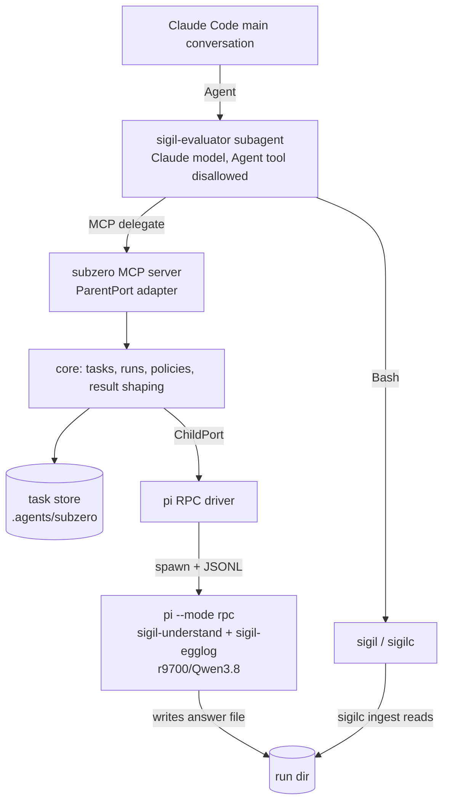
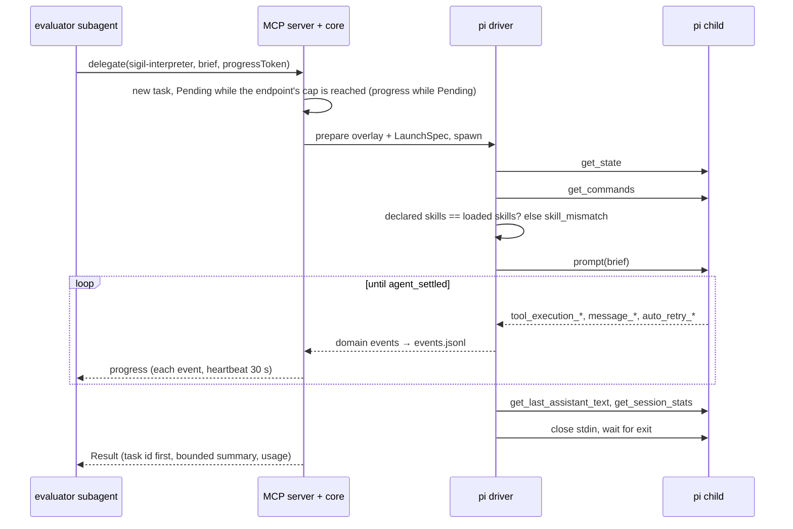
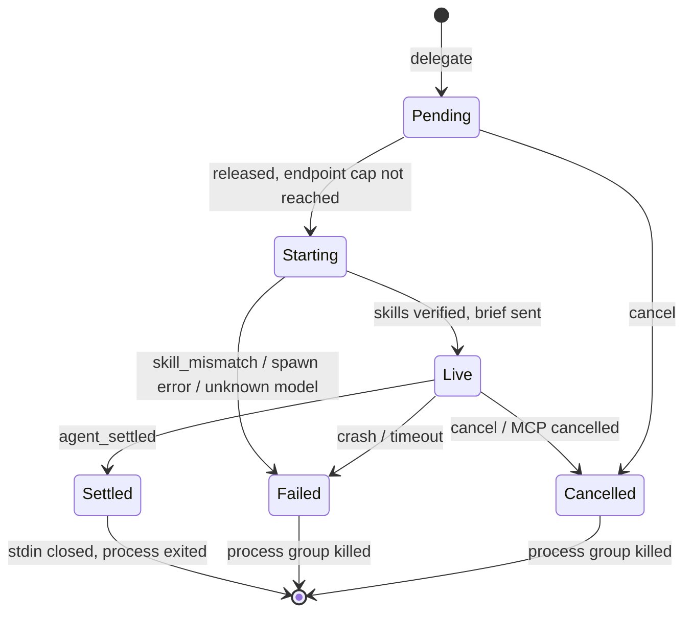
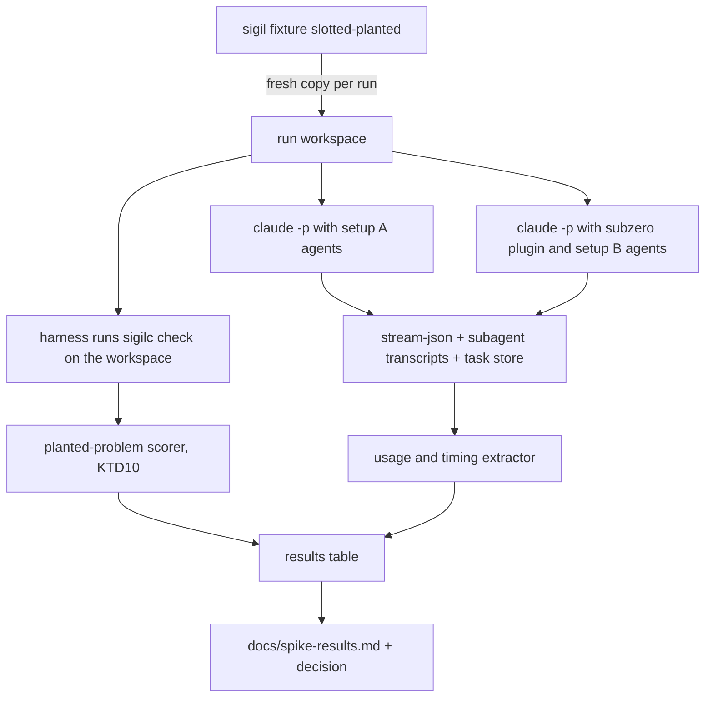

# subzero Spike - Plan

**Target repo:** subzero (this repo). **Related repo, read-only:** sigil (`$SIGIL_REPO`, locally `~/Workspace/sigil`); paths into it are written `sigil:<path>`. Nothing in sigil is modified.

---

## Goal Capsule

- **Objective:** We know, from measured numbers, whether handing a heavy skill's sub-agent work from Claude Code to a local Qwen model through subzero gives results good enough to use, at what cost and speed, while the main conversation stays clean — enough to decide whether to build subzero v0.1.
- **Means:** a minimal subzero (pi child driver, task store, Claude Code plugin with an MCP `delegate` tool) driving sigil-evaluate's interpreter children on pi + Qwen, compared against the same skill with Claude interpreter children (KTD2, KTD9, KTD10).
- **Authority:** Product Contract Requirements win on behavior; KTDs win on mechanism; the design docs in `docs/` are background and lose to this plan where they disagree (they are corrected in U1). The sigil contracts in `design/` win over this plan wherever they differ; this plan was brought into line with them after decisions made while writing them.
- **Stop conditions:** stop and return to brainstorming if U1 shows that a Claude Code subagent cannot be kept from using its Agent tool, cannot call a plugin MCP tool, or cannot reach the sigil skill files. Stop U8 early if B cannot reach a completed ingest on Slotted at any thinking level; run B-control before recording that as the result, so the cause is known.
- **Execution profile:** one developer machine with Claude Code 2.1.285, pi 0.87.0, Node 22, Deno, the `r9700/Qwen3.8` endpoint in `~/.pi/agent/models.json`, pi logged into Anthropic for B-control (today it holds only an xAI login), and built sigil binaries. Live model runs happen in U1, in the live checks of U3–U6, in U7's dry runs, and in U8.
- **Who finishes:** an implementer (`ce-work` or a person) completes U1–U7. U8 is run by the user with the harness from U7, and its decision is written by the user.

---

## Product Contract

### Summary

Build the smallest subzero that lets a Claude Code subagent delegate work to a pi + local Qwen child through one MCP tool, then measure it on sigil-evaluate against an all-Claude baseline that differs only in where the interpreter children run.

### Problem Frame

subzero's case (see `docs/problem.md`) rests on one unproven claim: a coding agent can hand a skill's work to a different model, including a local one, and get back something usable. Plumbing alone cannot answer it; a child can load the right skills, return a small result and exit cleanly while producing work the parent has to redo. sigil-evaluate is the test workload because it is heavy, it starts many fresh sub-agents (one interpreter per source plus re-asks), it leaves the delegation mechanism to the host, and sigil already scores interpreter output against an answer key of four planted problems.

Research for this plan changed one premise in the docs: Claude Code subagents *can* start their own subagents (up to three levels). So subzero is not filling a nesting gap here. The spike measures the cross-model claim only, which is the claim `docs/decisions.md` D1 says subzero must lead with.

### Requirements

**Delegation**
- R1. A Claude Code session with the subzero plugin can call `delegate` with an agent name and a brief, and receives exactly one bounded result per call, with the task id first and the summary at most the result budget (fixed at 2000 tokens, counted by estimate).
- R2. A child sees exactly the skills its agent declares; a missing skill folder or any difference between the declared and loaded skill sets fails the call as `skill_mismatch` before the brief is sent.
- R3. A child runs on the model and thinking level its agent declares, under the user's own pi login, with no user or project extensions, context files, prompt templates or other skills.
- R4. A child that hangs, crashes or overruns its timeout ends as a typed failure (`timeout`, `crashed`, `error`, or `skill_mismatch` per R2), and a cancelled child ends with the status `cancelled` and no failure kind; the parent call never hangs, and no pi process outlives Esc, a timeout, or the end of the Claude session. The timeout is a required number of seconds from spawn to settlement and does not count a wait in `Pending`.
- R5. A call that runs longer than a minute keeps the parent informed with progress at least every 60 seconds; a caller can also start a call without waiting and collect it later with `await`.
- R6. The agent file can cap, with a `parallel` limit on an `endpoints:` entry, how many children of one model endpoint (the provider part of `provider/model`) one process runs at a time, shared by every agent on it; further calls wait their turn, first come first served, instead of failing. A model endpoint with no entry has no cap, and the cap counts only the children of one process, not a terminal `subzero run` or a second session.

**Tasks**
- R7. Every call creates a task whose record outlives the parent session: `tasks` lists the tasks of the current conversation (at most 50, running first), a task whose owner process died is marked `abandoned`, `subzero attach` opens the child's session in the pi TUI, and `subzero show` exports its transcript.
- R8. subzero makes no snapshots or copies of workspace files and gates no writes; a child is limited only by its tool list, and the result carries no list of changed files. The user reviews the tree with git, including when a parent and a child write the same files, and the README says so.

**Experiment**
- R9. In setup B, the sigil-evaluator subagent starts every interpreter through `delegate` and none through Claude's Agent tool, and the main conversation loads no sigil skill or reference.
- R10. An interpreter child writes its claim rows to the exact answer file its brief names, in the form `sigilc ingest` accepts.
- R11. A and B run on the planted Slotted design with the same Claude model and effort for the evaluator. A's interpreter subagents inherit the evaluator's model. Three extra arms separate causes: A-cheap, where A's interpreter subagent runs on Haiku, B-control, where B's interpreter runs through subzero/pi on the same Claude model as A's interpreters, and B-low, where B's interpreter runs at the thinking level `low`. Each run records: planted-problem outcomes, final ingest state, re-asks used, units left unread, token usage split into main conversation / evaluator subagent / interpreter children, wall time, interpreter context use at settle, the thinking level of each pi interpreter, and any interpreter write outside its answer file.
- R12. The A/B results and the go / no-go decision for v0.1 are written down in one document.

### Key Decisions

- **Workload is direct sigil-evaluate.** It has the most sub-agents in the sigil set. Governs R9, R10, R11. (session-settled: user-directed — chosen over sigil-write: it only adds a second layer of sub-agents without testing anything new)
- **The evaluator is a native Claude subagent; only its interpreters go to pi.** Claude keeps the judgment, Qwen gets the narrow repeated job, and the main conversation stays clean. Governs R1, R9. (session-settled: user-directed — chosen over running the skill in the main conversation, which pollutes it, and over nested subzero delegation, which moves to v0.1)
- **Baseline A is the same evaluator subagent with Claude interpreter subagents.** Only the interpreter host differs between A and B. Governs R11. (session-settled: user-directed — chosen over running A in the main conversation: that mixes two variables)
- **No threshold; the decision is made from the table.** Governs R11, R12. (session-settled: user-approved — chosen over a fixed pass bar, following sigil's own benchmarks)
- **Git is the record.** Governs R8. (session-settled: user-directed — chosen over workspace snapshots and write gating)
- **Skills reach the child through a per-task overlay folder.** Governs R2. (session-settled: user-directed — chosen over pointing pi at the original skill folders)
- **The sigil repo is not modified.** Governs R11. (session-settled: user-approved — chosen over adding a subzero host to sigil's benchmark)

### Success Criteria

- Every plumbing requirement (R1–R10) is shown by a test or by the U1 / U8 runs.
- The U8 table lets a reader say, for each of the four planted problems, whether B found it as often as A, and what B cost in Claude tokens and time relative to A and to A-cheap.
- B-control lets the decision attribute any B shortfall to the model (Qwen) or to the subzero/pi path.

### Scope Boundaries

- Not built: `continue`, `ask`, `fork`, `rerun`, `report`, nested delegation inside subzero, `result.report_file`, generating `.claude/agents` files from `host: native`, config layering, `subzero.lock`, skill manifests, repo trust, Codex/Claude/ACP child drivers, and pi/Codex parent adapters.
- Not measured: sigil-write, and multi-window use of one task store.

#### Deferred to Follow-Up Work

- v0.1 items in `docs/decisions.md` "Suggested phasing", including sigil-write as the second workload.

### Sources

- `docs/target-claude-pi.md` (§2–§3 parent and child mechanics; §6 the spike as briefed), `docs/design.md` (§2 ports, §3 task model, §3.6 storage), `docs/decisions.md` (D1–D20, P1–P22).
- pi 0.87 RPC protocol: the installed package's `docs/rpc.md` (framing, `prompt`, `get_state`, `get_commands`, `get_session_stats`, `get_last_assistant_text`, `abort`, `clear_queue`, event list).
- Claude Code docs at code.claude.com/docs/en: `sub-agents` (nesting up to three levels; `tools`/`disallowedTools`; `skills:` preload rules; transcripts under `~/.claude/projects/{project}/{sessionId}/subagents/`), `mcp` (idle timeout 30 min stdio reset by progress; subagent calls never auto-background; `anthropic/alwaysLoad`), plugin manifest reference (`CLAUDE_PLUGIN_ROOT`, `CLAUDE_PLUGIN_DATA`, `${CLAUDE_PROJECT_DIR}` substitution).
- sigil: interpreter handoff contract `sigil:skills/sigil-compute-design/references/computed-evaluation.md:356-383`; answer key `sigil:scripts/slotted-benchmark/fixture.ts:168-325`; linked check and evidence validation `sigil:scripts/slotted-benchmark/claims.ts:61,528-600`; issue matching `sigil:scripts/slotted-benchmark/report.ts:420-554`; Claude launch flags `sigil:scripts/agent-runner/hosts.ts:196-252`; interpreter agent tools `sigil:scripts/slotted-benchmark/agents.ts:32-39`; manual review procedure `sigil:skills/sigil-evaluate/evals/claims-review-fixture.md`.

---

## Planning Contract

### Key Technical Decisions

- KTD1. **TypeScript on Node 22, one bundled server file.** The plugin's MCP server runs as `node ${CLAUDE_PLUGIN_ROOT}/dist/server.js` with no runtime install step (target §2.1). Dependencies stay small: the MCP TypeScript SDK, a YAML parser, a schema validator, a bundler, and a test runner. The measurement harness (U7) is Deno instead, because it imports sigil's own Deno TypeScript by path.
- KTD2. **Ports and adapters from day one.** A host-neutral core (tasks, runs, turns, policies, result shaping) talks to a `ChildPort` implemented only by the pi driver and is driven by a `ParentPort` implemented only by the MCP server and the CLI (design §2). (session-settled: user-approved — chosen over a throwaway prototype: the spike becomes the start of v0.1 at the cost of some structure)
- KTD3. **Own pi RPC client, targeting pi 0.87.** It splits stdout on LF only, decodes UTF-8 from a byte buffer, correlates responses by `id`, and treats `agent_settled` as done. pi's exported client is not used: its 60-second wait is too short for local models. Event types the client does not recognize are logged and ignored; pi 1.x support is v0.1.
- KTD4. **Child launch and verification.** Launch flags follow target §3.1 for 0.87: `--mode rpc --offline -na -ne -nc -np --no-themes -ns --skill <overlay>/<name>… --model … --thinking … --tools … --session-dir <store>/sessions --session-id <task-id> --name subzero:<agent>:<task-id>`, cwd = project root, env `PI_OFFLINE=1 PI_TELEMETRY=0`. After `get_state`, `get_commands` entries with `source: "skill"` must equal the declared set (R2). The overlay copies each declared skill folder side by side into `.agents/subzero/tasks/<task-id>/skills/`, so sibling `../` paths keep working.
- KTD5. **Process ownership.** Each child is spawned as the leader of its own process group, with stdio pipes kept and the handle never unref'd. Cancel and timeout go `clear_queue` → `abort` (5 s) → close stdin → SIGTERM to the group → SIGKILL to the group. If the server dies, pi sees stdin EOF and exits; a start-up sweep marks a task whose latest index line says running, and whose owner process (its pid and start time, recorded on the task's first index line) is gone or has another start time, as `abandoned`. The sweep runs at every start-up and again before a collect, a cancel or a listing, signals no process, and a stored result outranks a later `abandoned` line. The result is written in one step before its index line.
- KTD6. **Task store layout per design §3.6**, under `<project>/.agents/subzero/`: append-only `index.jsonl` (latest line per task wins), `tasks/<id>/task.json` with the frozen agent and LaunchSpec, `tasks/<id>/events.jsonl`, `tasks/<id>/turns/1.json`, and `sessions/` for pi. The task id `sz-` plus six base32 characters is also the pi session id. The project root comes from `SUBZERO_PROJECT_DIR` (set in `.mcp.json` from `${CLAUDE_PROJECT_DIR}`), then MCP `roots/list`, then the CLI's cwd for `subzero` commands; the MCP server never uses its own cwd. The delegation service resolves it once per process and hands the same root to the agent file, the task record and the child; an empty `SUBZERO_PROJECT_DIR` counts as unset, the first reported root wins, the root is absolute with symbolic links resolved, and when none resolves every call returns an error that names `SUBZERO_PROJECT_DIR`. The store folder is created readable by its owner only, with its own `.gitignore` that ignores everything in it; the user's own `.gitignore` is never edited.
- KTD7. **Concurrency is an optional cap per model endpoint** (the part of `provider/model` before the first slash). An `endpoints:` entry holds `parallel`, a positive whole number, and every agent on that endpoint shares it; an endpoint with no entry has no cap, and an entry that no agent belongs to is a load error. The delegation service counts the live children of its own process only and keeps a waiting call in `Pending`, released first come first served, still sending progress; the wait does not count toward the timeout. There are no lock files and nothing is signalled or locked across processes, so a terminal `subzero run` or a second session is not counted (R6). The README says so.
- KTD8. **MCP surface.** Four tools: `delegate(agent, brief, files?, expected_output?, wait?=true)`, `tasks(task?)`, `await(tasks, timeout_s)`, `cancel(task)`. Only `delegate` sets `_meta["anthropic/alwaysLoad"]: true`. When the request carries a progress token, progress goes out on every domain event, at most once a second, and on a 30-second heartbeat, as one line that names the agent, the kind of the latest event, the tool and its target path, and the elapsed time ("waiting" while `Pending`), never agent text or tool output. `tasks` returns at most 50 tasks, running first, with a notice of how many it left out. MCP `notifications/cancelled` for a waited call cancels its task (KTD5). Server `instructions` carry only the delegation rules: write a self-contained brief; the child cannot see this conversation.
- KTD9. **The evaluator subagent gets skills by path, not by `skills:` preload.** The sigil skills are staged outside every Claude discovery path, and the subagent prompt names the `SKILL.md` paths to read, as sigil's own harness does (`sigil:scripts/slotted-benchmark/agents.ts:115-121`). Reason: the docs say a `disable-model-invocation` skill cannot be preloaded, and do not say whether `skillOverrides` blocks preloading, so `skills:` cannot keep the main conversation clean (R9). In B the subagent sets `disallowedTools: [Agent]` and its prompt routes interpretation to `delegate` with agent `sigil-interpreter`; in A it keeps the Agent tool and has a Claude `interpreter` subagent with Read, Glob, Grep and Write, mirroring `sigil:scripts/slotted-benchmark/agents.ts:32-39`.
- KTD10. **Scoring without changing sigil.** Each run uses sigil's pass layout (`sigil:scripts/slotted-benchmark/agents.ts:41-48`): a pass directory, which is also Claude's cwd and project root, holding `root/` (the fixture copy), `store/` (an empty private claims store), `run/`, `skills/` (staged sigil skills) and `.agents/subzero.yaml`. The evaluator prompts name `root`, `store` and `run`. The Deno harness imports `preflightSlottedFixture`, `designViewFromTrees` and `validateLinkedEvidence` from the sigil checkout, and re-implements the unexported issue matcher (`sigil:scripts/slotted-benchmark/report.ts:420-554`, about 60 lines) with a pointer to its source. After a run it executes `sigilc check --root <pass>/root --store <pass>/store` itself and scores from that report, as sigil's benchmark does, so the score reflects what the interpreters read, not whether write-back succeeded. Review quality (the claims review fixture) stays a manual record.
- KTD11. **Minimal config.** The spike reads one `.agents/subzero.yaml` with `skills:` (name → path) and `agents:` (`description`, `host: pi`, `model`, `thinking`, `skills`, `tools`, `timeout`, a required number of seconds) and `endpoints:` (model endpoint → `parallel`, KTD7). It is validated on load, and any invalid agent, endpoint or a missing or malformed file is a load error that blocks every delegation until fixed. The file is read again on each delegation; an unknown agent name is an error that names every configured agent, with no task made. The evaluator agents exist only as Claude agent files (U6). No layering, lock file or trust step (Scope Boundaries).
- KTD12. **Approval boundaries.** A plugin cannot ship allow rules (target §2.7). Interactive use relies on a user or project rule `"allow": ["mcp__plugin_subzero_subzero__*"]`, which `examples/sigil/README.md` tells the user to add; without it, the subagent's `delegate` call raises an approval prompt in the main session. The harness runs with `--permission-mode dontAsk` and an explicit allow-list, so an unlisted tool is denied, never prompted. Inside the pi child there is no approval step at all: the agent's tool list is the whole boundary (R8).

### High-Level Technical Design

Components and who calls whom (B setup):



One `delegate` call, wait mode:



Run lifecycle inside one task:



Measurement data flow (U7, U8):



### Assumptions

- The `r9700` endpoint serves `Qwen3.8` with enough context for one interpreter request plus sigil-understand and sigil-egglog. Context use at settle (the session usage reports the value at the end, not its peak) is measured (R11) rather than assumed.
- `--plugin-dir` and `--agents` work together under `claude -p` with `--permission-mode dontAsk`; U1 confirms it before U7 depends on it.

### Risks

| Risk | Mitigation |
|---|---|
| pi 0.87 events differ from the documented shapes (sigil never ran pi live) | U3 records real JSONL fixtures in its first live run and the driver's tests run against them |
| `CLAUDE_PROJECT_DIR` is substituted in config but not exported to the server's env (docs disagree) | Pass it explicitly through `.mcp.json` `env` with `${CLAUDE_PROJECT_DIR}`; fall back to `roots/list` (KTD6) |
| Qwen thinking levels are silently ignored by the server (target §3.3) | U8 runs B at two levels and compares token counts; a no-difference result is recorded, not hidden |
| A local model loops or stalls inside a long tool chain | The per-agent `timeout` in the config maps to a `timeout` failure (R4) |
| An interpreter writes outside the answer file | Accepted by R8; git shows it, the U8 workspace is a throwaway copy, and the harness flags the pass from the interpreter's own transcript without failing it |
| A user-level `~/.pi/agent/SYSTEM.md` reaches the child despite `-nc` | Warned per run (U3); U8 runs on a machine where it is absent or recorded |
| pi's `grep`/`find` try to fetch helper binaries under `--offline` | Checked in U3's live run; the interpreter's tool list drops them if they fail |
| Interpreter runs draw on the same local GPU as anything else the user runs | `parallel: 1` on the r9700 endpoint (KTD7) holds only among this process's children; U8 runs with the endpoint otherwise idle and no second session |

---

## Output Structure

```text
package.json, tsconfig.json, build config     # U2
.claude-plugin/plugin.json                    # U5
.mcp.json                                     # U5
hooks/hooks.json                              # U5
src/
  config/        load + validate .agents/subzero.yaml           # U2
  core/          task model, store, delegation service, results # U4
  pi/            RPC client, driver, launch spec, overlay       # U3
  mcp/           MCP server (ParentPort)                        # U5
  cli/           subzero run | tasks | attach | show            # U4
test/
  fixtures/pi/   recorded pi RPC JSONL                          # U3
  fake-pi/       scripted pi stand-in for tests                 # U3
spike-checks/    U1 smoke scripts and their notes
bench/           Deno harness: stage, run A/B, score, tabulate  # U7
examples/sigil/  .agents/subzero.yaml (U3) + evaluator agent prompts (U6)
docs/spike-results.md                                           # U8
```

---

## Implementation Units

### U1. Gate checks and doc corrections

- **Goal:** Confirm the Claude Code behaviors the experiment rests on before building on them, and correct the design docs where research proved them wrong.
- **Requirements:** R9; stop conditions in the Goal Capsule.
- **Dependencies:** none.
- **Files:** `spike-checks/README.md`, `spike-checks/` (one throwaway plugin with a trivial stdio MCP echo tool, two agent definitions); `docs/target-claude-pi.md`, `docs/design.md`, `docs/decisions.md`.
- **Approach:**
  1. With a throwaway plugin loaded through `--plugin-dir`, check from inside a subagent: the plugin's MCP tool is callable; with `disallowedTools: [Agent]` the subagent cannot start a subagent; `${CLAUDE_PROJECT_DIR}` reaches the server through `.mcp.json` `env`.
  2. Check that a subagent can read and follow a `SKILL.md` at a path outside Claude's discovery paths, and that the main conversation's `/context` shows no sigil skill afterwards.
  3. Run the same checks under the harness's exact launch flags (U7 step 2), including that subagent transcripts are written.
  4. Correct the docs: remove "Claude Code subagents cannot start subagents" and its consequences from target §6.1, §7 and design §5.2; set D12 and the target R13 text to KTD9's routing; replace `--session <file>` with the task's `--session-dir`/`--session-id` in target §3.4 and design §6.3 (pi rejects the combination); record each check's result in `spike-checks/README.md`.
- **Execution note:** These are manual smoke checks with recorded observations, not automated tests.
- **Test scenarios:** Test expectation: none -- the unit verifies host behavior by observation; its output is the recorded result of each check.
- **Verification:** Each check in step 1–3 has a recorded pass or fail with the Claude Code version. Any fail on step 1 or step 2 triggers the stop condition.

### U2. Project scaffold and config

- **Goal:** A buildable, testable TypeScript project that loads and validates the spike's agent config.
- **Requirements:** R3, R11 (via config fields).
- **Dependencies:** U1 passes.
- **Files:** `package.json`, `tsconfig.json`, bundler config, `.gitignore` (including `.agents/subzero/tasks`, `.agents/subzero/sessions`), `src/config/schema.ts`, `src/config/load.ts`, `test/config/load.test.ts`.
- **Approach:** Initialize the repo with git. Implement KTD11's schema; resolve skill paths relative to the YAML file; resolve the project root per KTD6.
- **Test scenarios:**
  - A valid file with one `pi` agent loads, with skill names resolved to absolute folders.
  - An agent naming a skill missing from `skills:` is rejected with the agent and skill named.
  - A `pi` agent without `model` is rejected.
  - An unknown `host` value is rejected.
  - A skill path that does not exist on disk still loads; the missing folder is reported as `skill_mismatch` when a call launches (R2, tested in U3).
- **Verification:** The build produces `dist/server.js` from a placeholder entry, and the config tests pass.

### U3. pi RPC client and driver

- **Goal:** Start an isolated pi child, verify its skills, run one brief to settlement, and stop it cleanly in every exit case.
- **Requirements:** R2, R3, R4, R10.
- **Dependencies:** U2.
- **Files:** `examples/sigil/.agents/subzero.yaml`, `src/pi/jsonl.ts`, `src/pi/rpc-client.ts`, `src/pi/launch.ts`, `src/pi/overlay.ts`, `src/pi/driver.ts`, `test/fake-pi/fake-pi.ts`, `test/fixtures/pi/*.jsonl`, `test/pi/jsonl.test.ts`, `test/pi/driver.test.ts`, `test/pi/launch.test.ts`.
- **Approach:**
  1. JSONL framing and the client per KTD3.
  2. LaunchSpec and overlay per KTD4: copy declared skills side by side, check each folder exists before launch (target R2: pi ignores a missing `--skill` path silently).
  3. Driver flow per the sequence diagram; map events to the domain events of design §3.3 (`SkillsVerified`, `ToolActivity`, `AgentMessage` buffered not per token, `TurnSettled`, `RunExited`); status from the last assistant `message_end.stopReason` (`stop` → completed, `length` → completed-truncated, `error`/`aborted` → failed/cancelled).
  4. Process ownership per KTD5.
  5. Before launch, warn in the run's events when `~/.pi/agent/SYSTEM.md` exists, since `-nc` does not cover it (target R9).
  6. Write the `sigil-interpreter` agent into `examples/sigil/.agents/subzero.yaml` (`host: pi`, `r9700/Qwen3.8`, skills `sigil-understand` and `sigil-egglog`, tools `read,grep,find,ls,write`); U4's and U6's live checks reuse it.
  7. Record real JSONL from one live run of that agent on one Slotted source prepared by hand with `sigilc prepare` into `test/fixtures/pi/`, and note whether `grep`/`find` worked under `--offline` (target R11); if they did not, the interpreter's tool list drops them.
- **Execution note:** Build the framing and client test-first against the fake pi; record live fixtures before trusting the event mapping.
- **Patterns to follow:** pi's `docs/rpc.md` framing section; final-text extraction in `sigil:scripts/slotted-benchmark/agents.ts:344-355`.
- **Test scenarios:**
  - A JSON string containing U+2028 is delivered as one record, not split.
  - A multi-byte UTF-8 character split across two stdout chunks decodes correctly.
  - A response with a matching `id` resolves its command; an unrelated event in between is routed to the event stream.
  - Fake pi reports exactly the declared skills → brief is sent and the run settles with the last assistant text as summary.
  - Fake pi reports one extra skill → `skill_mismatch` naming the extra skill, no `prompt` sent, process killed.
  - A declared skill folder missing on disk → `skill_mismatch` before spawn.
  - Fake pi emits `agent_end` then more events then `agent_settled` → the run settles only at `agent_settled`.
  - Fake pi never settles → after the wall timeout the run is `timeout` and the whole process group is gone, including a grandchild the fake pi started.
  - Fake pi exits non-zero mid-turn → `crashed` with its stderr tail in the event log.
  - Cancel during a live turn → `clear_queue` and `abort` are sent, then the group is killed if the process is still alive after 5 s.
  - Unknown model → pi exits 1 before output → `error` naming the model.
  - An unrecognized event type is logged and the run continues.
  - A `SYSTEM.md` present in the pi agent dir (pointed at a temp dir in the test) → a warning event is recorded and the run still starts.
  - Replaying each recorded live fixture produces the same domain-event sequence.
- **Verification:** All driver tests pass against the fake pi, and one live run on Qwen settles with skills verified and a session file under `.agents/subzero/sessions`.

### U4. Core task model, store, delegation service and CLI

- **Goal:** Tasks with stable ids and durable records, one live run per task, a delegation service that owns the live registry, agent lookup, start-up and the optional per-endpoint cap, bounded results, and a CLI to run, list, attach and show.
- **Requirements:** R1 (result shape), R4, R6, R7, R8.
- **Dependencies:** U3.
- **Files:** `src/core/ids.ts`, `src/core/task.ts`, `src/core/store.ts`, `src/core/result.ts`, `src/core/service.ts`, `src/cli/main.ts`, `test/core/*.test.ts`, `test/cli/cli.test.ts`.
- **Approach:**
  1. Task, Run and Turn per design §3.1, limited to one turn per task in the spike; store per KTD6; the cap per KTD7, inside `service.ts`.
  2. Result per target §2.5, with no changed-file list: task id first, summary cut to the budget (head kept at a line boundary, an open code fence closed, a marker that names the omitted amount and says that `subzero show` has the full text; the status is unchanged), usage from `get_session_stats` with every field the driver cannot report marked unavailable and never zero.
  3. Start-up sweep per KTD5: `abandoned`, by owner pid and start time.
  4. CLI: `subzero run <agent> "<brief>"`, `subzero tasks`, `subzero attach <task>` (the LaunchSpec without `--mode rpc`; its `--session-dir` and `--session-id` reopen the existing session, and `--session` must not be added because pi 0.87 exits when it is combined with `--session-id`; refused while a run is live), `subzero show <task>` (`pi --export`).
- **Test scenarios:**
  - Two delegations to agents on the same endpoint → the second stays `Pending` until the first exits, then runs.
  - A `subzero run` in a second process is not counted against the cap of the server's process.
  - An unknown agent name returns the error that names every configured agent, and no task, record, index line or `Pending` run is made.
  - Two delegations on different endpoints → both run at once.
  - A cancelled `Pending` call never spawns pi.
  - A summary over budget is cut with a marker and the task id still comes first.
  - A child that creates a file is not reported by subzero: the result has no changed-files field in or outside a git repo.
  - The index keeps the latest line per task after three status updates, and a corrupt trailing line is skipped with a warning.
  - A task whose latest line says running and whose owner pid is dead, or alive with another start time, is marked `abandoned`; a live owner's task is left running; a task whose record holds a result stays settled whatever a later `abandoned` line says.
  - `attach` on a task with a live run is refused; on a settled task it builds the LaunchSpec without `--mode rpc` and without `--session`.
  - Integration: `subzero run` against the fake pi writes `task.json`, `events.jsonl`, `turns/1.json` and an index line, and prints the result.
- **Verification:** A live `subzero run sigil-interpreter "<brief>"` against one prepared Slotted source writes an answer file that `sigilc ingest` accepts, and `subzero attach` opens the session afterwards.

### U5. MCP server and Claude Code plugin

- **Goal:** Claude Code can delegate, wait with progress, background, cancel and list tasks through the plugin.
- **Requirements:** R1, R4, R5, R7.
- **Dependencies:** U4.
- **Files:** `src/mcp/server.ts`, `src/mcp/tools.ts`, `src/mcp/progress.ts`, `.claude-plugin/plugin.json`, `.mcp.json`, `hooks/hooks.json`, `test/mcp/server.test.ts`.
- **Approach:**
  1. Tools and instructions per KTD8, backed by the core service.
  2. `.mcp.json` passes `SUBZERO_PROJECT_DIR=${CLAUDE_PROJECT_DIR}` and `SUBZERO_DATA=${CLAUDE_PLUGIN_DATA}` in `env` (Risks).
  3. SessionStart hook records the Claude session id so `tasks` can scope to "this conversation" (target R4).
  4. Tool names stay within the `mcp__plugin_subzero_subzero__<tool>` form.
- **Patterns to follow:** target §2.1–§2.6; the U1 throwaway plugin.
- **Test scenarios:**
  - `tools/list` returns four tools and only `delegate` carries `anthropic/alwaysLoad`.
  - `delegate` with `wait: true` and a progress token emits progress for each domain event and at least every 30 s of silence, then returns the result.
  - `delegate` with `wait: false` returns the task id at once; `await` on it returns the result when it settles, and `await` with a short timeout returns nothing for a still-running task.
  - `notifications/cancelled` for a waited call ends the task as `cancelled` and kills the child (fake pi).
  - `delegate` with an unknown agent returns a tool error naming the configured agents.
  - Closing the server's stdin while a child runs leaves no pi process (fake pi).
  - `tasks` with no argument returns only tasks recorded for the current Claude session id, at most 50, running first, with a notice of how many were left out; with no known session id it lists every task and says so.
- **Verification:** In an interactive Claude Code session with `--plugin-dir`, a delegation to the fake-pi-backed agent shows progress, Esc cancels it with no orphan process, and a call longer than two minutes from the main conversation auto-backgrounds and its result arrives. Without the allow rule of KTD12, a `delegate` call made from a subagent raises an approval prompt in the main session; under `claude -p --permission-mode dontAsk` without it, the call is denied and the subagent sees the denial.

### U6. sigil experiment wiring

- **Goal:** The two setups exist as files: subzero config for the interpreter, and evaluator agent definitions for A and B.
- **Requirements:** R9, R10.
- **Dependencies:** U5.
- **Files:** `examples/sigil/.agents/subzero.yaml` (from U3), `examples/sigil/agents/evaluator-a.md`, `examples/sigil/agents/evaluator-b.md`, `examples/sigil/agents/interpreter-a.md`, `examples/sigil/agents/interpreter-a-cheap.md`, `examples/sigil/agents/evaluator-b-control.md`, `examples/sigil/agents/evaluator-b-low.md`, `examples/sigil/README.md`.
- **Approach:**
  1. Point the `sigil-interpreter` agent's skill paths from U3 at the pass layout's `skills/` folder (KTD10), and add `sigil-interpreter-control`: the same agent on `anthropic/<A's interpreter model>` for B-control, and `sigil-interpreter-low`: the same as `sigil-interpreter` at thinking `low` for B-low (R11). `sigil-interpreter` and `sigil-interpreter-low` share the `r9700` endpoint entry with `parallel: 1`.
  2. `interpreter-a-cheap` is `interpreter-a` with `model: haiku`; A-cheap's evaluator points to it.
  3. Evaluator prompts per KTD9: name the staged `SKILL.md` paths and the pass's `root`, `store` and `run` (KTD10); B adds the routing line ("to interpret a prepared sigilc request, call `delegate` with agent `sigil-interpreter`; the brief carries the request, binding and guidance paths, the exact answer file path and the round") and `disallowedTools: [Agent]` (B-control's copy routes to `sigil-interpreter-control` and B-low's to `sigil-interpreter-low`; the three differ only in that routing); A keeps the Agent tool and points to `interpreter-a`.
  4. The README shows how to use B interactively: copy `evaluator-b.md` into `.claude/agents/`, and add `"allow": ["mcp__plugin_subzero_subzero__*"]` to a user or project settings file first (KTD12). It also warns that subzero does not track what a child writes (review the tree with git; keep a parent and a child, or two children, from writing the same files), that the store folder holds plain text and ignores itself, that the user's own `.gitignore` is not edited, that two Claude sessions in one project may mix the tasks listed for their session id, that the cap holds only among one process's children and an endpoint with no entry (a Claude model) has none, and that the command line has no cancel, so a `subzero run` ends only by Ctrl-C in its terminal.
- **Test scenarios:** Test expectation: none -- configuration and prompts; their behavior is exercised by U7's dry run and U8.
- **Verification:** One interactive B run on Slotted shows every interpreter call in the task store, none in Claude's subagent list, and a completed or explicitly incomplete ingest state in the evaluator's report.

### U7. Measurement harness and scorer

- **Goal:** One command runs A or B on a fresh copy of the planted Slotted design and writes a row of R11's measures.
- **Requirements:** R11.
- **Dependencies:** U6.
- **Files:** `bench/deno.json`, `bench/stage.ts`, `bench/run.ts`, `bench/score.ts`, `bench/usage.ts`, `bench/table.ts`, `bench/score_test.ts`, `bench/usage_test.ts`, `bench/README.md`.
- **Approach:**
  1. Stage a fresh pass directory per KTD10: `root/` from `sigil:scripts/slotted-benchmark/fixtures/slotted-planted` with its `.sigil/config.json` and no claims store, empty `store/` and `run/`, the sigil skills in `skills/`, and `.agents/subzero.yaml` copied from `examples/sigil`; put the built `sigil` and `sigilc` first on PATH.
  2. Run one of the five arms (A, A-cheap, B, B-control, B-low; R11): `claude -p --output-format stream-json --verbose` from the pass directory with that arm's `--agents` JSON, `--plugin-dir` for B, `--permission-mode dontAsk` and an allow-list covering Read, Write, Glob, Grep, `Bash(sigil *)`, `Bash(sigilc *)`, the shell programs the compute contract needs (`Bash(mkdir *)`, `Bash(cp *)`, `Bash(mv *)`, `Bash(ls)`, `Bash(ls *)`, `Bash(cat *)`, `Bash(test *)`, `Bash(cmp *)`, as in `sigil:scripts/slotted-benchmark/agents.ts:20-29`), plus `Agent` for A or `mcp__plugin_subzero_subzero__*` for B. The prompt asks the main conversation to have `sigil-evaluator` review the design.
  3. Score per KTD10 against `SLOTTED_FIXTURE`.
  4. Usage: main-conversation tokens from stream-json; evaluator and A-interpreter tokens from the subagent transcripts; B-interpreter tokens and context use at settle from the task store's `get_session_stats` records, and the declared thinking level from each launch spec. Read each interpreter's writes from its own transcript with paths normalized against the pass directory, and flag, never fail, a pass with a write other than its answer file; a write into the claims store makes the score untrustworthy.
  5. Table: one markdown row per run, appended to `bench/results/`.
- **Execution note:** Prove the scorer first: scoring a workspace from one of sigil's own `.benchmarks/` runs must reproduce that run's report.
- **Patterns to follow:** `sigil:scripts/slotted-benchmark/claims.ts:528-600` for the check invocation and evidence validation; `sigil:scripts/agent-runner/hosts.ts:219-245` for Claude flags, except `--no-session-persistence` (it suppresses the subagent transcripts step 4 reads) and `--strict-mcp-config` (it drops the plugin's MCP server in B).
- **Test scenarios:**
  - Scoring the stored workspace of an existing sigil benchmark run gives the same per-issue outcomes as its `report.md`.
  - A workspace with an anchor Facet unread scores that issue as N/A, not missed.
  - A finding with matching class and law but the wrong subject is counted as extra, not as a match.
  - The usage extractor counts a cumulative token counter once, not per event (claims-review-fixture.md rule).
  - Usage from a stream with two subagent transcripts is split per subagent.
  - A run that exits without the evaluator's report is recorded as failed and kept in the table, not dropped.
- **Verification:** A dry run of A and of B each produce a table row with every R11 column filled or marked unavailable with a reason.

### U8. Run the comparison and record the decision

- **Goal:** The A/B table exists and a written go / no-go for v0.1 follows from it.
- **Requirements:** R11, R12.
- **Dependencies:** U7.
- **Files:** `docs/spike-results.md`.
- **Approach:**
  1. Three matched passes each of A and B on the same design revision and the same Claude model and effort, as the claims review fixture prescribes; B at thinking `high`, plus one B pass at `low`, one A-cheap pass and one B-control pass (R11).
  2. For each pass, record the review-quality observations the claims review fixture asks for (which planted problems the evaluator's final report names) next to the scorer's results.
  3. Write `docs/spike-results.md` with the table, failed passes kept with their reasons, and the plumbing checks of R1–R10 with evidence pointers; the user writes the decision paragraph in that file.
- **Test scenarios:** Test expectation: none -- this unit runs the experiment; its evidence is the results document.
- **Verification:** `docs/spike-results.md` holds six or more counted passes or an explicit early stop, and a decision paragraph that cites the table.

---

## Verification Contract

| Gate | Command or check | Proves |
|---|---|---|
| Unit and integration tests | `npm test` | U2–U5 test scenarios, run against the fake pi and recorded fixtures |
| Type check and bundle | `npm run build` | `dist/server.js` builds as one file with no runtime install |
| Harness tests | `deno test` in `bench/` | U7 scorer and usage scenarios |
| Live pi smoke | `subzero run sigil-interpreter "<brief>"` on one prepared source, then `sigilc ingest` | R2, R3, R10 against the real endpoint |
| Plugin smoke | interactive Claude Code with `--plugin-dir .` | R1, R4, R5 behaviors listed in U5 Verification |
| Orphan check | process list after Esc, timeout and session exit shows no `pi --mode rpc` | R4 |
| Experiment | U7 harness runs, results in `docs/spike-results.md` | R11, R12 |

Live-model checks are run by hand and are not part of `npm test`.

---

## Definition of Done

- U1 records a pass for every gate check, or the run stopped at a recorded fail.
- U2–U7 verification outcomes hold and the gates above pass.
- `docs/spike-results.md` exists with the table and the decision (U8).
- `docs/target-claude-pi.md`, `docs/design.md` and `docs/decisions.md` no longer claim that Claude Code subagents cannot nest.
- No code from abandoned attempts remains in the diff; `spike-checks/` keeps only the scripts and notes U1 records.
