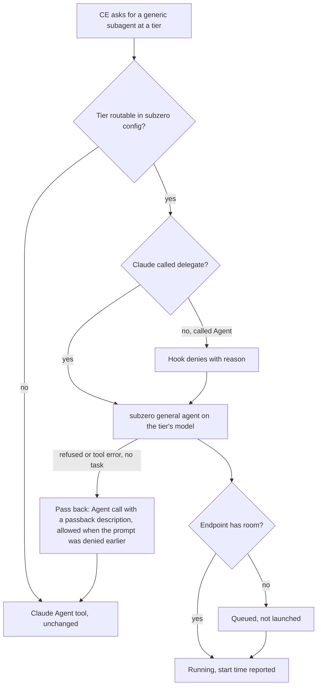
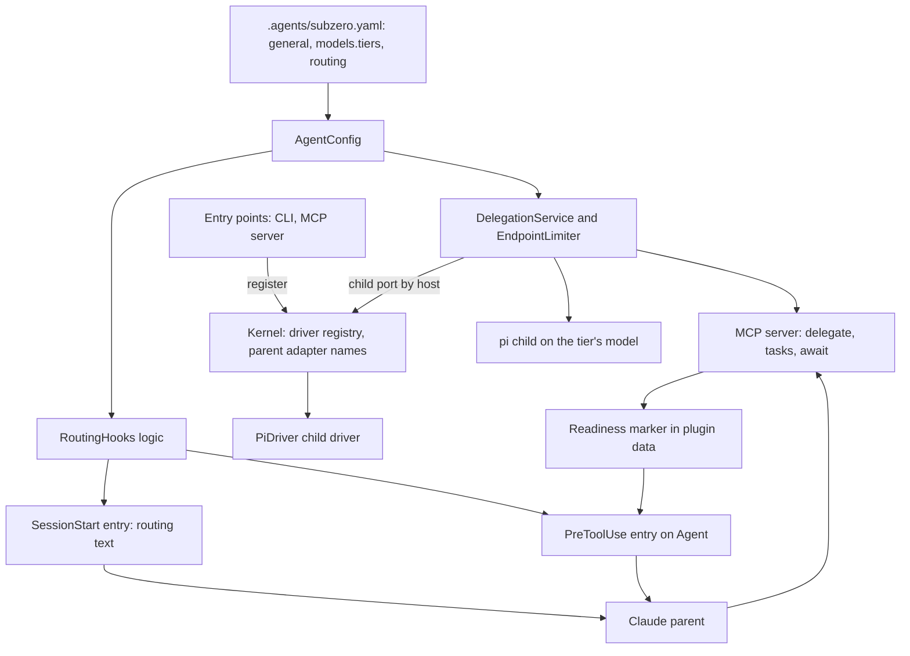
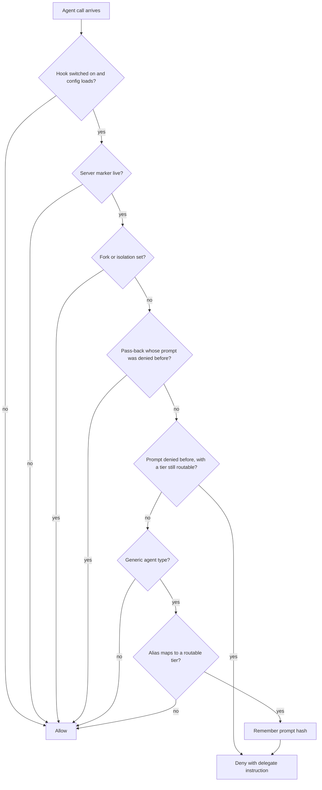
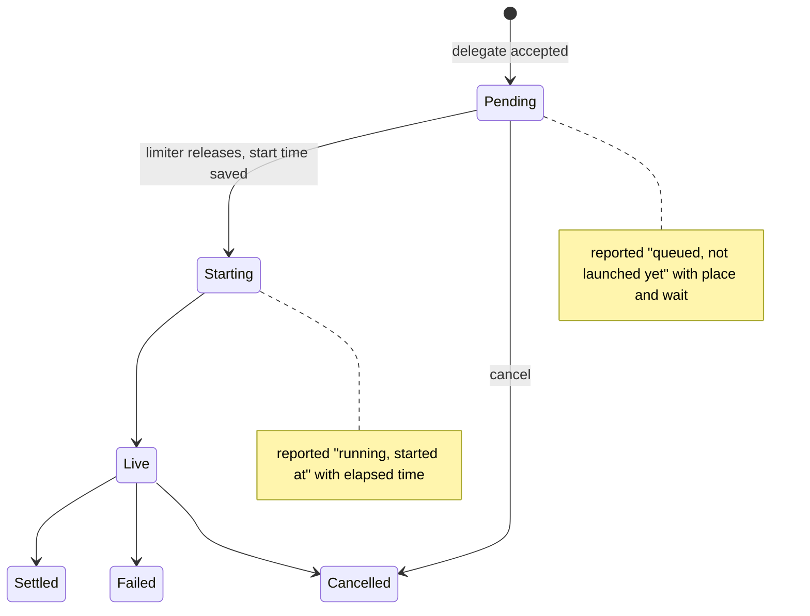
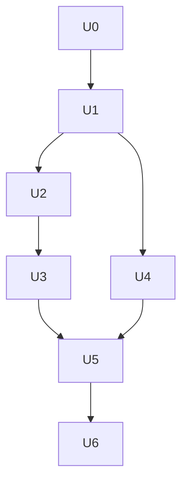

# Tiered Subagent Routing - Plan

## Goal Capsule

- **Objective:** A developer running compound-engineering (CE) skills in Claude Code can send each CE subagent tier to a model they chose in subzero config, including non-Claude models, without editing CE or mapping skills one by one, and CE reviews still finish with every reviewer's findings.
- **Means:** a `general` agent, a read-only `fallback` agent and the `models.tiers` map in `.agents/subzero.yaml`, routing text injected at session start, a hook that redirects tiered generic Agent spawns to `delegate` and lets a refused spawn pass back to Claude, an honest queued status, and a small Kernel so that no core service names a child driver or a parent adapter (KTD1, KTD3, KTD5, KTD6, KTD14 to KTD17).
- **Product authority:** the Product Contract below. The tier schema replaces the per-host `models.tiers` of `docs/design.md` §4 with tiers that carry host, model and thinking (R2); `docs/design.md` was updated to match. The R-IDs win on behavior; KTDs win on mechanism.
- **Execution profile:** Deep, seven units in dependency order (U0 to U6). TypeScript, vitest with the fake pi, and the `design/*.sigil` files updated alongside the code they describe. The designs for U0 to U5 are already written, including `design/kernel.sigil` and `design/routing-hooks.sigil`; the code follows them.
- **Stop conditions:** stop and ask if a hook input lacks a field the routing decision needs, such as the Agent `description` that identifies a pass-back, and no fail-open reading of it keeps R18. Stop and ask if the R17 run loses a reviewer for a reason outside routing and status, such as a CE prompt that pi cannot follow.
- **Who finishes:** `ce-work` implements U0 to U5 and the setup half of U6. The R17 run needs a person at a machine with Claude Code logged in, CE installed and endpoint `r9700` reachable.

---

## Product Contract

Product Contract preservation: changed. R18 to R22 were added, and R7, R9 and R10 were extended. Research found gaps that would fail the agreed pass bar, and the user confirmed them at plan scoping. The Success Criteria now exempt worktree and fork spawns (user-directed). The three Outstanding Questions were resolved as KTD6, KTD10 and KTD4.

Revised 2026-11-09 at the user's direction. Tiers now carry host, model and thinking, with a required `default` tier, per-agent `tier:` and per-agent `tiers:` overrides; agents no longer carry host, model or thinking (R1, R2, R3, R6, R7, KTD1, KTD10 rewritten). Earlier on the same day: R23 to R26 were added (a read-only `fallback` agent for unknown agent names, `subzero init`, the pass-back, and a microkernel for child drivers and parent adapters), R3 now follows the registered child drivers instead of naming `pi`, R19 and the third Success Criterion carry one deliberate exception for the pass-back, and a delegation that names no agent runs `general` as before. The Scope Boundary that fixed `general.host` to `pi` now says only that `pi` is the one child driver that exists. KTD14 to KTD17 and unit U0 carry the mechanism.

### Summary

`.agents/subzero.yaml` gains a `general` agent and a `models.tiers` map.
At session start the plugin tells Claude to send each CE tier that config defines (cheapest capable, mid-tier, session model) to subzero instead of Claude's own Agent tool, and a hook catches spawns that slip past.
A task waiting on a full endpoint is reported as queued rather than started, so CE does not run its reviewer clock against queue time.
The work is accepted when `/ce-code-review` on the demo routes every configured tier through subzero and no reviewer fails.

### Problem Frame

CE skills never name agents or models. Each one asks the host for a "generic subagent" and states the model as a tier: the session model, a balanced mid-tier, or the cheapest capable model. In Claude Code the parent turns those words into Claude's Agent tool with an alias such as `sonnet`, so every CE subagent runs on an Anthropic model. Claude Code offers no setting that points its Agent tool at another provider, and its docs state that routing to non-Claude models through a gateway is unsupported.

subzero can already run a child on any model pi reaches, but only through agents named in `.agents/subzero.yaml`, and `delegate` requires one. A CE skill cannot use that without per-skill setup. An earlier design sketch described tiers (`model: tier:medium` resolved through `models.tiers`), but nothing implements them, and this plan replaces that form: tiers carry host, model and thinking, and agents carry none of them (R1, R2).

A second gap surfaced while checking the code: when an endpoint is at its `parallel` limit, `delegate` with `wait: false` still answers "started" for a task that is only queued. CE gives each reviewer 20 minutes from its launch, so on a one-GPU endpoint the reviewers late in the queue would time out in CE's eyes before they ever ran.

### Key Decisions

- **Route by CE's own tier words, not per skill.** One instruction covers every CE skill because all of them use the same three tier words. Governs R4, R12.
- **A tier routes only when config defines it.** No tiers configured means CE runs exactly as it does today; configuring the top tier is how a user opts the session-tier reviewers in. Governs R4, R5, R13. (session-settled: user-directed — chosen over always keeping the session tier on Claude: the config decides, not a fixed rule)
- **Tiers hold host, model and thinking; agents do not.** `models.tiers` is the one place that says what runs a child, with a required `default` tier. An agent runs on the tier a call names, else its own `tier:`, else `default`, and may override any tier's fields for itself in a `tiers:` block, as docker-compose overrides a base service. So `general` has a default plus one variant per tier, and any named agent can take a tier too. Governs R1, R2, R3, R6, R7. (session-settled: user-directed — chosen over tiers that only swap the model per host, which left `general`'s host and reasoning fixed across tiers)
- **`general` and `fallback` are entries of `agents:` with no description.** Named `general` and `fallback`, they are found by a plain name lookup, so no agent name is reserved and an explicit request for either works. `general` is the default for unnamed and tiered work, and neither is chosen by description or offered in the routed agent catalog. Governs R1, R6, R23, R24. (session-settled: user-directed — chosen over top-level entries beside `agents:`, which needed reserved names and made an explicit `fallback` inconsistent)
- **Instructions are injected at session start, never written to CLAUDE.md.** No file is written, nothing goes stale when tiers change, and nothing is left behind when the plugin is removed. Governs R12. (session-settled: user-approved — chosen over writing a block into CLAUDE.md: avoids changing a committed file)
- **Instructions plus a redirecting hook.** Instructions alone let Claude slip back to its native Agent tool and the full-coverage bar would fail without a signal; a native shim agent would start CE's clock at the Agent call and bring back the queue problem. Governs R12, R14, R15. (session-settled: user-approved — chosen over instructions only and over a native shim agent: the hook guarantees routing)
- **The hook never strands Claude.** It fails open when subzero cannot serve the call, and it remembers what it denied so a changed model alias cannot route around it. Governs R18, R19. (session-settled: user-approved — chosen over a hook that denies unconditionally: a down server would otherwise block every reviewer)
- **Worktree and fork spawns stay on Claude.** A subzero child starts in the shared checkout and sees only its brief, so it cannot honor either request. Governs R20 and the Success Criteria. (session-settled: user-directed — chosen over adding a worktree mode or a scratch copy to `delegate` now: keeps worktree mode a later item)
- **`general` gets read, write and bash.** CE reviewers write their findings file and run read-only git commands; pi has no path sandbox, so this also lets a confused child change the repo. Governs R8. (session-settled: user-directed — chosen over read-only: full CE fidelity)
- **Queue on a full endpoint; do not reject.** Today's first-come-first-served queue stays. Governs R11. (session-settled: user-directed — chosen over rejecting over-capacity calls as backpressure: keeps current behavior)
- **Report queued tasks as not launched.** The fix is in what subzero reports, so CE starts each reviewer's clock when the child actually runs. Governs R9, R10. (session-settled: user-directed — chosen over a higher-parallel test endpoint, rejecting tiered calls, or loosening the pass bar: keeps queueing and full coverage together)
- **Pass bar is routing plus full coverage.** Governs R17 and the Success Criteria. (session-settled: user-directed — chosen over routing proof alone and over an A/B run against native)
- **Child drivers and parent adapters plug in through a small Kernel.** More children (Claude, Codex) and more parents will come, so no core service, including the CLI and the delegation service, names or imports a driver or an adapter. Governs R3, R25. (session-settled: user-directed — chosen over letting the core import `PiDriver`: the core stays unchanged when a driver is added)
- **An unknown agent name runs a read-only `fallback` agent, and no name runs `general`.** A mistyped name still gets work done but cannot write or run shell commands. Governs R6, R23, R24. (session-settled: user-directed — chosen over failing the call and over falling back to `general`, which has write and bash)
- **A pass-back is the way back to Claude's Agent tool.** When `delegate` is refused or errors before any task exists, Claude re-spawns the same prompt with a description that begins with `passback`, and the hook lets it through when it had denied that prompt earlier. Governs R26. (session-settled: user-approved — chosen over an always-allowed pass-back, which would be a way around the routing, and over a server-verified permit, which adds a hook-to-server file contract)

### Requirements

**Configuration**

- R1. The `agents:` map of `.agents/subzero.yaml` accepts an entry named `general` with no description that takes unnamed and tiered work. Agent entries carry only what an agent does (description, skills, tools, timeout); they never carry a host, a model or a thinking level directly.
- R2. `models.tiers` maps each tier name to a host, a model and a thinking level, and a tier named `default` is required whenever `agents:` holds an entry. An agent runs on the tier a call names, else on its own optional `tier:`, else on `default`. An agent's optional `tiers:` block overrides any of host, model and thinking of a named tier for that agent only, like a docker-compose override.
- R3. An agent can run at a tier only when the host of its resolved definition (the tier's host after the agent's own override) has a registered child driver, which is `pi` today. A tier whose host has no driver still loads and a request that resolves to it fails with an error that names the tier, the configured tiers, the host and the supported hosts. The routable tiers are only a listing of the tiers the general agent can run, used for the tool description and the hook, and there are none while `agents:` holds no `general` entry; the host of the resolved definition decides whether any agent runs. AgentConfig takes the supported hosts from its caller, which gets them from the Kernel, and checks no host when it is given none. The delegation service and the MCP server's tool listing pass them; `subzero init` and the hook process pass none.
- R4. The tier names cover CE's three dispatch tiers: `small` for "cheapest capable", `medium` for "mid-tier", and `large` for "session model".
- R5. A tier that config does not define, or that is not routable (R3), is never routed, and a config with no tiers changes nothing about how CE runs.
- R24. The `agents:` map accepts an entry named `fallback`, with no description and the keys of any agent. A description on `general` or `fallback` fails the load, and no agent name is reserved. The command `subzero init` takes a model and the named options `--host`, `--timeout` (default 1200 seconds, the length of CE's reviewer budget) and `--thinking` (default `medium`), and adds a `default` tier with that host, model and thinking, and a `general` entry and a read-only `fallback` entry under `agents:` with that timeout, each only when the file does not hold it yet, without changing any existing line; the tool lists come from the host's child driver, so the core names no tool, and the project root comes from the delegation service.

**Delegation**

- R6. `delegate` can be called without a named agent, which runs `general` with its full tool list, and with any agent plus a tier, which runs that agent on that tier (with the agent's override for it). Naming `general` does the same as naming nothing, and so does `subzero run` with no `--agent` option (the agent is a named option, so a lone argument is always the brief).
- R23. A name that `agents:` does not hold runs the `fallback` agent when the config has one, records its agent as `fallback`, and the reply says the named agent is not configured. Without a `fallback` entry the caller gets the unknown agent error that lists the configured agents, as today. Naming `general` when no `general` entry exists is the same as naming nothing: the unknown agent error, and `fallback` never runs in its place.
- R7. An unknown tier, or a tier whose host has no registered child driver, is rejected before launch with the list of configured tiers and a pointer to dispatch that subagent through Claude's own Agent tool instead, as a pass-back (R26).
- R8. `general` children can read, write and run shell commands, including on paths outside the project such as CE's persona files and run directory.
- R9. A task waiting for endpoint capacity is reported as queued, with its endpoint, place in line and time spent waiting, by `delegate`, `tasks` and `await`; no reply calls it started until a child is running.
- R10. Once a task's child is running, every status reply for it shows when it started and how long ago that was.
- R11. Over-capacity tasks keep waiting first come first served, and waiting time still does not count toward the agent's timeout.
- R21. The `delegate` tool description lists each routable tier and the host and model it runs.
- R22. `await` returns each collected task's result whole up to that task's share of the result limit, and says how to fetch the full result of any task it had to cut.

**Routing inside Claude Code**

- R12. At session start the plugin adds instructions to Claude's context, built from the current config: which CE tier words map to which configured tier, that those dispatches go to `delegate` with that tier instead of the Agent tool, and that a queued subzero task has not launched yet.
- R13. When no tier that a CE tier word (`small`, `medium`, `large`) maps to is routable (none configured, no `general` entry, or only a `default` or custom-named tier), the plugin adds no routing instructions and the hook lets every spawn through.
- R14. A hook on Claude's Agent tool denies a generic spawn whose requested tier is routable, and its reason tells Claude to call `delegate` with that tier and the same prompt; spawns of named specialist agents and spawns for unconfigured tiers pass through.
- R15. Config can turn the hook off while keeping the injected instructions.
- R16. Named agents in `agents:` and calls that name them behave as they do today, and no CE file changes.
- R18. The hook lets every spawn through when the subzero server is not running for this project or the config fails to load, and in the load-failure case the session-start text is a one-line warning instead of routing instructions.
- R19. After the hook denies a spawn, a later Agent call in the same session with the same prompt is denied too, whatever model it asks for, as long as the tier the denial kept is still routable, except a pass-back (R26).
- R20. Worktree-isolated spawns and fork spawns always pass through the hook.
- R26. When `delegate` is refused or returns a tool error and made no task, Claude can pass the subagent back to its own Agent tool by re-spawning the same prompt with a short description that begins with `passback`. The hook allows that spawn only when the deny memory already holds its prompt, and a pass-back of a prompt that was never denied is routed like any other spawn. A `delegate` call that returned a task id is never passed back, even if its result is failed. The session-start text and the deny reason both say this.

**Architecture**

- R25. A Kernel keeps a registry that maps each host to one child driver, and the names of registered parent adapters. No core service (Kernel, AgentConfig, TaskCore, TaskStore, DelegationService, the CLI) names, imports or depends on a particular child driver or parent adapter. Each process's entry point registers the drivers and adapters it needs. A child driver receives the project root, the sessions folder and its driver-files folder through the child port, and offers its attach command, session export and starter tools through the registry. A parent adapter reaches the core only through DelegationService (its delegation, collect, cancel and listing) and AgentConfig, and through the Kernel only to list the supported hosts it gives AgentConfig, and is never given a child driver. A second driver for one host, or a second adapter with one name, is refused.

**Acceptance run**

- R17. The work is accepted by running `/ce-code-review` on the bug files in `examples/demo` from Claude Code with the subzero and CE plugins installed and at least the `medium` tier configured on endpoint `r9700`.

### Key Flows

- F1. CE review dispatch with tiers configured
  - **Trigger:** `/ce-code-review` selects its reviewers and dispatches them as one batch.
  - **Steps:** Claude reads the injected instructions and calls `delegate` with the matching tier for each configured tier; reviewers whose tier is not configured go to Claude's Agent tool as before; a generic Agent spawn for a configured tier is denied by the hook and re-dispatched through `delegate`; subzero runs as many children as the endpoint allows and reports the rest as queued; CE waits on each task and starts its 20-minute clock when the task reports it started.
  - **Outcome:** every selected reviewer returns findings and CE merges them into one report. When `delegate` is refused or errors before any task exists, Claude passes that reviewer back to its own Agent tool (R26) and the review still finishes.
  - **Covered by:** R6, R9, R10, R12, R14, R26

### Acceptance Examples

In every example below the config also holds a `default` tier and a `general` entry, because tiered work runs on `general` and `general` needs the default tier.

- AE1. Only the mid tier configured
  - **Covers R4, R5, R12, R14.**
  - **Given** `models.tiers` defines `default` and `medium` (no other tier word), and `agents:` holds `general`.
  - **When** `/ce-code-review` runs.
  - **Then** CE's mid-tier reviewers run as subzero tasks on the `medium` model, and the correctness, security and adversarial reviewers run natively on Claude.
- AE2. Top tier configured
  - **Covers R4, R5, R14.**
  - **Given** `models.tiers` also defines `large`.
  - **When** any generic Agent spawn asks for no model, from CE or from the user's own work.
  - **Then** the hook redirects it to `delegate` on `large`.
- AE3. No tiers configured
  - **Covers R5, R13.**
  - **Given** `.agents/subzero.yaml` has no agents and no `models.tiers`, or has a `default` tier only.
  - **When** `/ce-code-review` runs.
  - **Then** no routing instructions are injected, the hook passes every spawn, and CE runs entirely on Claude. (A file with agents and no `default` tier fails the load, so the session-start text is the one-line warning and the hook allows every spawn, R18.)
- AE4. More reviewers than the endpoint serves
  - **Covers R9, R10, R11.**
  - **Given** six reviewers routed to `medium` on `r9700` with `parallel: 1`.
  - **When** CE dispatches all six at once.
  - **Then** one reports running with its start time and five report queued; each later reports its own start time when it runs, and CE records none as failed.
- AE5. Claude spawns natively anyway
  - **Covers R14.**
  - **Given** `medium` is configured.
  - **When** Claude calls the Agent tool for a generic subagent with `model: sonnet`.
  - **Then** the hook denies it with a reason naming `delegate` and the tier, and Claude dispatches the same prompt through `delegate`.
- AE6. A named specialist agent
  - **Covers R14, R16.**
  - **Given** `medium` is configured.
  - **When** Claude spawns a named specialist agent, such as `Explore`, with `model: sonnet`.
  - **Then** the hook lets it through.
- AE7. subzero is down
  - **Covers R18.**
  - **Given** `medium` is configured and the subzero MCP server is not running for the project.
  - **When** Claude spawns a generic subagent with `model: sonnet`.
  - **Then** the hook lets it through and the review finishes on Claude.
- AE8. Alias switch after a deny
  - **Covers R19.**
  - **Given** `medium` is the only tier word configured (with `default` and `general`) and the hook denied a generic `sonnet` spawn.
  - **When** Claude retries the same prompt with no model or with `haiku`.
  - **Then** the hook denies it again with the same `delegate` instruction.
- AE9. Mutation-testing reviewer
  - **Covers R20.**
  - **Given** `medium` is configured.
  - **When** CE spawns its testing reviewer with `isolation: worktree` and `model: sonnet`.
  - **Then** the hook lets it through and Claude runs it in its own worktree.
- AE10. Unknown agent name
  - **Covers R23, R24.**
  - **Given** a config with a `general` entry and a read-only `fallback` entry, and no agent named `reviewr`.
  - **When** Claude calls `delegate` with the agent `reviewr`.
  - **Then** the child runs as `fallback` with its read-only tools, the task records its agent as `fallback`, and the reply says `reviewr` is not configured. A call that names `fallback` itself runs it with no such notice. With no `fallback` entry the call returns the unknown agent error and makes no task.
- AE11. No agent named
  - **Covers R6.**
  - **Given** a `general` entry.
  - **When** Claude calls `delegate` with a brief and no agent and no tier.
  - **Then** the child runs as `general` with its full tools and the task records its agent as `general`.
- AE12. Pass-back
  - **Covers R19, R26.**
  - **Given** `medium` is configured, the hook denied a generic `sonnet` spawn, and `delegate` then returned a tool error with no task.
  - **When** Claude calls Agent with the same prompt and a short description that begins with `passback`.
  - **Then** the hook lets it through and Claude runs it natively. The same prompt with a description that does not begin with `passback` is still denied, and a `passback` spawn whose prompt was never denied is routed like any other spawn.
- AE13. `subzero init`
  - **Covers R24.**
  - **Given** a project with no agent file and one registered host, `pi`.
  - **When** a person runs `subzero init` with a model.
  - **Then** the agent file holds a `default` tier (host `pi`, the given model, thinking `medium`) and a `general` and a `fallback` entry under `agents:`, with the full pi tool list and `read, grep, find, ls`, each with a 1200-second timeout. Running it again changes nothing and says all three entries are already there; with a `general` entry already present it adds only what is missing; with a `default` tier on another host it refuses naming both hosts and writes nothing.

### Success Criteria

- Every CE dispatch for a configured tier in the R17 run appears as a subzero task whose recorded launch shows that tier's model, except worktree-isolated and fork spawns (R20).
- Every CE dispatch for an unconfigured tier in that run ran natively on Claude.
- No Agent call in that run was allowed with a prompt the hook had earlier denied, except a pass-back (R26) after `delegate` was refused or errored with no task. A pass-back in the run is listed with the `delegate` error that caused it.
- CE's final report lists no failed reviewer and includes findings from every selected reviewer.

### Scope Boundaries

- CE's script-driven runs (cross-model peer review in `ce-code-review`, `ce-doc-review`, `ce-pov` and `ce-work`, and model elevation in `ce-brainstorm` and `ce-plan`) start CLIs directly and never pass through the Agent tool; CE's own config already sets their models.
- Claude and Codex child drivers. The Kernel gives them a place to plug in (R25), but `pi` is the only child driver that exists, so `pi` is the only supported host until another registers.
- Parents other than Claude Code. A pi or Codex parent has no native Agent tool to redirect.
- Tiers in a user-level config file and the layering of skill manifests (design D17). Tiers live in the workspace file for now.
- Rejecting over-capacity calls as backpressure, and any change to CE itself.

#### Deferred to Follow-Up Work

- A worktree mode for `delegate` (design D8), which would let worktree-isolated spawns route too.
- A plain model id on `delegate` alongside tiers.
- Cancelling several tasks in one call, and an endpoint queue shared across Claude sessions.
- Per-host tool lists. An agent entry now has one `tools:` list while its tiers can name different hosts; decide at the second host whether the list is per host or portable.
- A use for the Kernel's parent adapter names beyond refusing a duplicate, such as listing adapters or recording the parent on each task. Add it when a second parent exists.
- A server-verified pass-back: the MCP server writes a permit keyed by the brief hash when `delegate` errors with no task, and the hook allows a pass-back only with a permit. The deny-memory rule in R26 is the cheaper bound for now.
- A hook-side host check. The hook process has no registered child driver, so a host the Kernel does not support shows up as a `delegate` tool error and the pass-back answers it.

### Dependencies / Assumptions

- Claude Code lets a `PreToolUse` hook deny an Agent call with a reason Claude sees, and lets a `SessionStart` hook add context (Claude Code docs, `hooks.md` "PreToolUse decision control" and "SessionStart").
- CE follows an instruction that names a model for a tier (`skills/ce-brainstorm/references/model-tiers.md` in the CE repo, line 11) and corrects a dispatch rejected before launch once (same file, line 13).
- CE counts each reviewer's 20 minutes from its own launch (`skills/ce-code-review/references/dispatch-reviewers.md`, line 55; `subagent-template.md`, line 150).
- pi's file tools resolve absolute paths and `~` with no containment, so a child can read CE's persona files and run directory.
- Unverified: Claude treats a task reported as queued as not yet launched for CE's clock across a whole queue. The R17 run is what proves it.
- Unverified: the `PreToolUse` hook input for the Agent tool carries the call's short `description`, which is how the hook recognizes a pass-back (R26). U5 checks this first against a real hook input. If the field is absent, stop and ask (Goal Capsule): the pass-back would need another marker.

### Outstanding Questions

All three questions deferred from the brainstorm are resolved in the Planning Contract: the alias table in KTD6, tiers-only `delegate` in KTD10, and the queued wording in KTD4. None block planning.

### Sources / Research

- `docs/design.md` §4 (`models.tiers`) and `docs/decisions.md` D5, D8, D10, D12, P11.
- `src/config/agent-config.ts` (host fixed to `pi`, no tiers), `src/mcp/server.ts` (`delegate` schema), `src/service/delegation-service.ts` (endpoint queue and the "started" reply), `src/mcp/session-hook.ts` and `hooks/hooks.json` (the existing SessionStart hook).
- CE repo: `skills/ce-code-review/references/dispatch-reviewers.md` (tiers, batch dispatch, backpressure rule), `skills/ce-brainstorm/references/model-tiers.md`, and the "generic subagent" paragraph repeated across about 15 skills.
- pi-subagents (`agents/delegate.md`, `src/runs/shared/model-resolution.ts`): the generic `delegate` agent plus a per-call model is the pattern that lets CE run on Pi without config.
- Claude Code docs: `sub-agents.md` (model resolution order, Agent `model` takes aliases only), `hooks.md` (hook input and output contracts, 10,000-character context cap), `plugins/components.md` (plugin tool names `mcp__plugin_<plugin>_<server>__<tool>`), `llm-gateway.md` (non-Claude models via gateways unsupported).

---

## Planning Contract

### Key Technical Decisions

- KTD1. **Tiers hold host, model and thinking; agents resolve against them.** `loadAgentFile` validates `models.tiers` (each tier needs host, model and thinking; `default` is required when `agents:` has entries) and rejects host, model or thinking set directly on an agent. An agent definition is an agent entry resolved at one tier: the tier the call names, else the entry's `tier:`, else `default`, with the entry's `tiers.<name>` override applied field by field. Endpoint, `parallel`, timeout and the frozen task record follow from the resolved definition exactly as before. A tier is **routable** when its host (after the general agent's override) has a registered driver and `agents:` holds a `general` (there are no routable tiers without one); the hook, which has no Kernel, treats every configured tier that a tier word (small, medium, large) maps to as routable and relies on the pass-back when `delegate` refuses; a `default`-only or custom-named tier has no tier word and is never hooked. The endpoint-in-use check counts the models of tiers and of overrides. Governs R1 to R3, R6, R7.
- KTD2. **A tiered task records its agent as `<agent>:<tier>`.** For the general agent that is `general:<tier>`. Listings, launch names and `task.json` then show which tier ran, and the frozen definition plus `--model` in the launch spec are the routing proof the Success Criteria need. An untiered call that names no agent, or names `general`, records `general`, and a call that falls back to the read-only agent records `fallback`, because its tool list is its own and not the general one (KTD15).
- KTD3. **Queued is derived from live state, not stored.** The stored status stays `running` for Pending, Starting and Live tasks, because `sweep`, `list`, `formatListing` and the CLI all key on `running`. The MCP server reads queued against running from the live task state and the limiter's queue. The task's endpoint and enqueue time are persisted when `delegate` accepts it, and its start time when the limiter releases it. A task of another process that is stored as `running` with no start time is therefore shown as queued, with its wait counted from enqueue and no place in line. Governs R9, R10.
- KTD4. **One owner for status wording.** `src/mcp/format.ts` renders every state line. Queued reads "queued, not launched yet: no child is running; it starts when endpoint `<e>` has room (place `<n>` in this session's queue, waiting `<elapsed>`)". Running reads "running, started `<iso>` (`<elapsed>` ago)". The words "this session's queue" are deliberate: the limiter is per process. Governs R9, R10.
- KTD5. **Routing hooks are their own design component.** A new `RoutingHooks` component owns an importable logic module and two thin entry scripts. The logic covers the alias table, the generic-spawn test, the routing text, the deny decision and the deny reason. The hooks read config through `CLAUDE_PROJECT_DIR`, reusing `setting()` from `src/mcp/parent-session.ts`. The design records this as a named exception to the rule in `design/delegation-service.sigil` that only `DelegationService` resolves the project root. Governs R12 to R15, R18 to R20.
- KTD6. **Alias table and generic test.** A missing model maps to `large`, `haiku` to `small` and `sonnet` to `medium`, and a spawn is redirected only when that tier is routable (KTD1). `opus` and `fable` skip the alias mapping, because the hook cannot tell them from the session model, but deny memory still applies to them (R19). A spawn is generic when `subagent_type` is absent, `general-purpose` or `claude`, and that list can be overridden in config. `fork` and any spawn with `isolation` set pass before the table is consulted. The hook matcher is `Agent|Task`, so older Claude Code builds are covered too. Governs R4, R14, R20.
- KTD7. **Readiness markers for fail-open.** When it connects for a project, each MCP server writes a marker named by its own pid in that project's folder under the plugin data folder, records its parent pid (the Claude Code process that started it) in the marker, and removes the marker on exit. The hook denies only when a marker names a live process whose recorded parent pid is one of the hook's own ancestor processes, and the config loads. Two Claude sessions on one project therefore never remove each other's readiness, and a session whose own server is down never relies on another session's server. Any error inside the hook means exit 0 with no output. Governs R18.
- KTD8. **Deny memory by prompt fingerprint.** The hook records each denied prompt as its own create-only file, named by the prompt's hash, in a per-session folder under the plugin data folder, and denies any later Agent call with the same prompt in that session while the tier that entry keeps is still routable. No write reads or replaces another entry, so the hook processes of one concurrent batch cannot lose each other's entries. The deny reason is a short imperative:
  - the exact tool `mcp__plugin_subzero_subzero__delegate`, `tier: "<t>"`, the prompt unchanged as `brief`, and `wait: false`,
  - then "this is a routing rule, not an error; do not call Agent again for this subagent and do not change its model", except that when `delegate` is refused or returns a tool error with no task, Claude calls Agent again with the prompt unchanged and a short description that begins with `passback` (KTD17).
  Governs R14, R19, R26.
- KTD9. **One batch pattern, whatever Claude's tool concurrency is.** The injected text tells Claude to dispatch every routed subagent with `delegate(tier, brief, wait: false)` in one message, then call `await` with all the ids and up to 600 seconds, repeating until all are done. It also states that a task's launch time is its `started` time. `await` is marked always-loaded, like `delegate`, so tool search cannot hide it. Governs R12, R9.
- KTD10. **`delegate` takes an agent, a tier, both or neither.** `agent` becomes optional. `tier` accepts `medium` or `tier:medium` and applies to any agent, which records `<agent>:<tier>`. The description is built at ListTools time from a fresh config read and lists the routable tiers with host and model (R21, KTD1). `SERVER_INSTRUCTIONS` stays limited to delegation rules (`design/mcp-server.sigil`) but drops "configured agent". Governs R6, R7, R21.
- KTD11. **Per-task share of the result limit.** `await` gives each collected task an equal share of `TOOL_RESULT_LIMIT` instead of bounding the joined text once. A cut section ends with `tasks(<id>)` as the way to read the whole result. CE's compact reviewer returns are small, so the share rarely bites. Governs R22.
- KTD12. **Routing settings live in `subzero.yaml`.** A `routing:` block holds the hook switch and the generic agent list, beside `agents:` and `models`. That keeps one config source the hooks and the server both read, at the cost of being per project rather than per user. Governs R15.
- KTD13. **The SessionStart entry stays one process.** `src/mcp/session-hook.ts` keeps recording the session id and now also prints the `hookSpecificOutput.additionalContext` JSON. The routing text is kept far under the 10,000-character cap. The hook has no matcher, so it re-injects on resume, `/clear` and compaction. Governs R12, R13.
- KTD14. **A Kernel owns the two seams, and entry points compose.** A new `Kernel` (`design/kernel.sigil`) holds the driver registry (host to one child driver, a second registration for a host refused with the host named), lists the supported hosts, and hands out the child port, attach command, session export and starter tools of the driver for a host. It also refuses a second parent adapter of one name, and keeps those names only for that refusal. It imports nothing particular. The CLI process and the MCP server process each have an entry point that imports `PiDriver` and registers it; the MCP server's entry point also registers `McpServer` as a parent adapter, and the hook processes run no Kernel, register nothing and import no driver. The entry points of the CLI and the MCP server are outside `Cli` and `McpServer`. `DelegationService`, `TaskCore`, `TaskStore`, `AgentConfig` and the CLI ask the registry and import no driver. The child port gains the project root, the sessions folder and the driver-files folder on each start, so `PiDriver` no longer depends on `TaskStore`. `child session`, `attach command`, `session export` and `child driver` become shapes of `TaskCore`, and `queued task` a shape of `DelegationService`. Governs R3, R25.
- KTD15. **`fallback` is an agent entry, and read-only comes from what `init` writes.** `AgentConfig` loads `general` and `fallback` as agent definitions of `agents:` that have no description, and names no tool, because only the host knows which tool names only read, so the load cannot enforce it. `DelegationService` runs `fallback` for an unconfigured agent name and records `fallback`, and a call that names `fallback` runs it with no "not configured" notice; with no entry the call fails with the unknown agent error. Governs R23, R24.
- KTD16. **`subzero init` writes the starter entries through `AgentConfig`.** The command asks the registry for the host's starter tools (a full list for `general` and a read-only list for `fallback`) and asks `AgentConfig` to add a `default` tier (host, model and thinking level, default `medium`) and the two entries to `agents:` (timeout, default 1200 seconds), each only when absent, with no skills, leaving every existing line unchanged and writing nothing when the file does not load. It uses the project root that the delegation service resolved and hands over. It refuses, naming both hosts and writing nothing, when the file already holds a `default` tier on another host than the one given. It adds the `default` tier alone to a file that holds agents and no `default` tier, and writes nothing when the file fails to load for any other reason. The `--host` option may be left out when exactly one host is registered, and `init` refuses with a message that no host is registered when the registry lists none, with one that names every supported host when the host is missing and several are registered or is not supported, and with one that names the host when its child driver offers no starter tools. For `pi` the starter tools are `read, bash, edit, write, grep, find, ls` and `read, grep, find, ls`. Governs R24.
- KTD17. **The pass-back is bounded by the deny memory, and the hook checks no host.** The hook allows a spawn whose short description begins with `passback` only when the session's deny memory holds its prompt hash, whatever tier that entry keeps, before the deny memory can deny it. A `passback` spawn with a prompt that was never denied goes through the rest of the flow. The routing text and the deny reason tell Claude to pass back only when `delegate` is refused or returns a tool error with no task, and to leave a returned task id with subzero even when its result fails. The hook process has no registered child driver, so it checks no host: a host the Kernel does not support appears as a `delegate` tool error and is answered by the pass-back. Governs R19, R26.

### High-Level Technical Design

The components and who reads what:

The hook's decision for one Agent call:

What each task state reports:

### System-Wide Impact

- **Every Agent spawn in the session passes the hook.** That includes the user's own subagents and other plugins' agents, not only CE. Named agent types, `opus`, `fable`, forks and isolated spawns pass untouched (KTD6), and each spawn costs one short Node process.
- **Prompt context grows in every project with tiers.** The routing text is added at each session start, resume, `/clear` and compaction (KTD13), so it must stay short.
- **The plugin data folder gains two kinds of files.** Readiness markers are removed on exit, and a marker left by a crashed server is ignored because its pid is dead (KTD7). Deny-memory folders are per Claude session (KTD8); U5 deletes any older than seven days when it writes a new entry.
- **Failure propagation stays one-directional.** A hook error allows the spawn (R18). A server crash mid-batch leaves its tasks `running` in the store, and the existing `sweep` marks them abandoned on the next start.
- **Claude Code's permission prompts do not cover the child.** A `general` child's writes and shell commands run inside pi, outside Claude Code's permission system. This is the accepted trade-off behind R8, and the demo copy contains it for R17.
- **The pass-back is a bounded hole in R19.** The hook cannot tell whether `delegate` really failed, so a pass-back is trusted once the prompt was denied (KTD17). The Success Criteria list each pass-back in the R17 run with its `delegate` error.
- **Entry points become part of the design.** Wherever a process starts, its entry point imports and registers the drivers and adapters it needs, and a driver that no entry point registers is absent from that process (KTD14). The hook process registers none.
- **Parity with the native Agent path.** Batch dispatch, bounded waits, collection and cancel all have `delegate`/`await`/`cancel` equivalents (KTD9). Worktrees and forks do not, which is why R20 passes them through.

### Assumptions

- If the hook input carries no `subagent_type` when the caller omits it, KTD6 treats absence and `general-purpose` the same way, so either reading is safe.
- CE reviewer templates name Claude tools such as Read and Grep. The pi child has `read`, `grep`, `find`, `ls`, `edit`, `write` and `bash` and is expected to map them; a failed reviewer in R17 is checked for this before queue timing is blamed.
- Whether Claude Code re-adds SessionStart context after compaction is not documented. The hook fires on compaction regardless, and the PreToolUse hook does not depend on the text being present.

### Sequencing

U0 comes first because U1 takes the supported hosts from the Kernel and U3 and U5 use its seams. U1 comes next because every other unit reads the resolved tiers. U2 and U3 both change `src/service/delegation-service.ts` and `src/mcp/server.ts`, so U2 lands before U3. U4 needs U1. U5 needs U3, so the deny reason and the `delegate` schema use the same argument names, and it also needs U4. U6 needs everything.

### Risks

| Risk | Mitigation |
|---|---|
| Design drift: every `src/**` file implements a `design/*.sigil` component, and four designs state rules this plan changes. | Each unit updates its designs in the same change. The Verification Contract runs a computed Sigil check over the changed components. |
| A `general` child with write and bash edits the repo during a review. | The R17 run uses a copy made by `./demo.sh setup`. Real repos keep this risk, which the user accepted. |
| Two Claude sessions on one endpoint each think they hold `parallel: 1`. | KTD4 wording names "this session's queue". An endpoint queue shared across sessions is deferred. |
| `examples/sigil/.agents/subzero.yaml` and `examples/demo/.agents/subzero.yaml` carry host, model and thinking on their agents, which the load now rejects, and `test/wiring/wiring.test.ts` pins the sigil one. | U1 migrates both with the schema: `design/sigil-wiring.sigil` already describes the sigil file as `default`, `low` and `control` tiers on pi with `sigil-interpreter`, `-low` and `-control` agents each on its tier. Any other agent file written before this change fails the load with the entry named and must be migrated the same way; no compatibility mode is offered. |
| A pass-back is a trust-based way around routing: Claude could label any spawn `passback`. | The hook allows it only for a prompt already in the deny memory (KTD17), and the R17 run lists every pass-back. A server-verified permit is deferred. |
| The `fallback` agent is read-only only by what `init` wrote, and a person can edit it. | `AgentConfig` cannot know tool names (KTD15). The decision is recorded in the design, and `init` writes the read-only list. |
| The Kernel refactor touches the CLI, the delegation service and `PiDriver` before any routing work. | U0 lands first with the existing tests unchanged, so a regression shows before routing code arrives. |

---

## Implementation Units

### U0. Kernel, driver registry and `subzero init`

**Goal:** Put the two seams in place so that no core service names a child driver or a parent adapter, and give the CLI an `init` command, before any routing work builds on them.

**Requirements:** R3, R24, R25; KTD14, KTD15, KTD16.

**Dependencies:** none.

**Files:**
- `src/kernel/kernel.ts` (new)
- `src/core/task-core.ts` (child port gains project root, sessions folder and driver-files folder; `attach command`, `session export`, `starter tools` shapes)
- `src/store/task-store.ts` (provides the driver-files folder)
- `src/service/delegation-service.ts` (asks the registry for the child port)
- `src/cli/main.ts` (attach and show go through the registry; `init` command)
- `src/pi/driver.ts`, `src/pi/overlay.ts` (take their folders from the child port; offer starter tools)
- `src/mcp/main.ts` (entry point registers `PiDriver` and the parent adapter)
- `design/kernel.sigil`, `design/task-core.sigil`, `design/task-store.sigil`, `design/delegation-service.sigil`, `design/cli.sigil`, `design/pi-driver.sigil`
- `test/kernel/kernel.test.ts` (new), `test/cli/cli.test.ts`, `test/service/delegation-service.test.ts`, `test/pi/driver.test.ts`

**Approach:**
1. Add `Kernel` with `registerChildDriver(host, driver)`, `childPort(host)`, `supportedHosts()`, and `registerParentAdapter(name)`. Errors name the host or the name, and an unsupported host's error lists every supported host.
2. Move the child-port shape, `attach command`, `session export` and `starter tools` into `TaskCore`, and have the child port take the project root, sessions folder and driver-files folder with each start. `PiDriver` stops importing `TaskStore`.
3. Make `DelegationService` and the CLI ask the registry for the child port, attach command and session export of a host, and refuse with the host named when a driver offers none. No file outside `src/pi/` and the entry points imports `src/pi/`.
4. Add the entry points: the CLI main and the MCP server main import and register `PiDriver` before the first request, and the MCP server main also registers `McpServer` as a parent adapter.
5. Add the `subzero init` command to the CLI (KTD16, R24); it calls the starter-entries write that `AgentConfig` gains in U1, so its tests land with U1.
6. Update the six designs as already drafted.

**Patterns to follow:** the existing `src/cli/main.ts` command structure, and the `manualPort()` helper in the delegation tests for a fake driver.

**Test scenarios:**
- A request for the child port of a host with no registered driver returns an error that names the host and lists every supported host, and starts no child.
- A second driver for `pi` is refused with `pi` named and the first stays registered. A second parent adapter with one name is refused with the name.
- With `PiDriver` registered, a delegation runs on the fake pi as before. A static check finds no import of `src/pi/` from `src/core/`, `src/store/`, `src/service/`, `src/config/`, `src/kernel/` or `src/cli/` other than the entry points.
- Attach and show go through the registry, and a driver that offers neither refuses with its host named.
- Covers AE13 (lands with U1, which owns the `AgentConfig` write). `subzero init` with a model and no `--host`, with one registered host, creates the agent file with a `default` tier, `general` and a read-only `fallback`; running it again changes nothing; with an existing `general` it adds only what is missing; with an unloadable file it writes nothing and exits non-zero; with no registered host, or several and none given, or an unsupported host, or a host whose driver offers no starter tools, it refuses naming the cause. With a `default` tier on another host it refuses naming both hosts and writes nothing; with agents and no `default` tier it adds the tier.
- `subzero run` with no `--agent` runs `general`, and with no `general` entry prints the unknown agent error and runs nothing (never `fallback`).

**Verification:** The existing delegation, CLI and driver tests pass unchanged except where a unit names the change, and the import check passes.

### U1. Config: `general`, `fallback`, `models.tiers` and `routing`

**Goal:** Load and validate the new config entries, resolve one agent definition per tier, and write the starter entries for `init`.

**Requirements:** R1, R2, R3, R4, R5, R11, R15, R24; KTD1, KTD2, KTD6, KTD12, KTD15.

**Dependencies:** U0.

**Files:**
- `src/config/agent-config.ts`
- `design/agent-config.sigil`
- `docs/design.md` (§4.2 load rules only)
- `examples/sigil/.agents/subzero.yaml` and `examples/demo/.agents/subzero.yaml` (migrate to tiers)
- `test/config/agent-config.test.ts`, `test/wiring/wiring.test.ts`

**Approach:**
1. Treat the entries named `general` and `fallback` in `agents:` as agent definitions that take no `description`: reject a description on them, and leave them out of anything built from descriptions (the routed catalog and proxy skills).
2. Parse `models.tiers` as a map of tier name to `{host, model, thinking}` (all required, `default` required when `agents:` has entries), each agent's optional `tier:` and `tiers:` override block (only host, model, thinking), and `routing` as an optional switch plus an agent-type list. Reject host, model or thinking set directly on an agent.
3. Resolve an agent at a tier on request: the tier named, else its `tier:`, else `default`, then apply its `tiers.<name>` override field by field (KTD1). Expose the configured tier names and the routable ones (host has a registered driver) separately.
4. Count the models of tiers and overrides in the endpoint-in-use check, and let `agents:` hold only `general`.
5. Replace the host message with one that names the supported hosts, which the caller takes from the Kernel (R3). Add a tier error that carries the configured tier list, in the shape of `UnknownAgentError`.
6. Add the write that `init` uses: given a host, a model, a thinking level, a timeout and the two tool lists, add a `default` tier and `general` and `fallback` entries, each only when the file lacks it, with no skills, leaving every existing line unchanged, refuse with the load error when the file exists and does not load for a reason other than a missing `default` tier (which it adds), and refuse naming both hosts, writing nothing, when the file has a `default` tier on another host (KTD16).
7. Update the agent-config design: its state, constraints and cases cover `general`, `fallback`, tiers and `routing`. Reword "host always pi" and the endpoint-entry rule, which now counts `fallback` too.

**Patterns to follow:** `validateAgent` hand checks before zod, lower-case `LoadError` messages that name the entry, `UnknownAgentError` with a `configured` list, and a fresh read on every call with no caching.

**Test scenarios:**
- A config with `default` and `medium: { host: pi, model: r9700/Qwen3.8, thinking: low }` and a `general` entry loads, and `general` at `medium` has that host, model and thinking, endpoint `r9700` and that endpoint's `parallel`.
- A `reviewer` with `tier: medium` resolves to `medium` with no tier named and to `large` (as `reviewer:large`) when `large` is named; its `tiers.large: { model: X }` override changes only the model.
- An agent entry with `model:` set directly, a `tiers:` override for an unconfigured tier, and a file with agents but no `default` tier each fail the load naming the entry.
- A config whose `agents:` holds only `general` loads.
- An `endpoints.r9700` entry used only by a tier model loads, where today it would fail as unused.
- A tier with `host: claude`, when only `pi` is registered, loads and is not routable, and resolving it raises the tier error naming `claude` and `pi`.
- A file with no agent entries and no `models.tiers` loads with no tiers. A file with agent entries and no `default` tier fails the load naming `default`, and an agent's own `tier:` or `tiers:` key that names an unconfigured tier fails it naming the entry.
- `routing.hook: false` and a custom generic agent list are read back as given.
- An unknown key inside `general` or `fallback` fails the whole load with the entry name first.
- A `fallback` entry loads with its own tool list, the general agent's tool list is unchanged, and a file with `general` and no `fallback` loads with no fallback agent.
- A `general` or `fallback` entry that holds a `description` fails the load naming it, and an agent named `reviewer` still loads with its `description`.
- Rewriting the file between two calls returns the new tiers, so nothing is cached.
- Adding the starter entries to a file with a `general` entry adds only what is missing, leaves every existing line as it was, and the file loads afterwards. A file that holds agents and no `default` tier gets the `default` tier added; one whose `default` tier is on another host than the one given is refused, naming both hosts, with nothing written; a missing file is created with all three.

**Verification:** Config tests pass, and the existing agent-config tests pass, except those that set host, model or thinking directly on an agent, which move into tiers.

### U2. Honest queued and started status

**Goal:** `delegate`, `tasks` and `await` tell a queued task from a running one and report start times and elapsed times.

**Requirements:** R9, R10, R11; KTD3, KTD4.

**Dependencies:** U1.

**Files:**
- `src/core/task-core.ts`
- `src/service/delegation-service.ts`
- `src/store/task-store.ts`
- `src/mcp/format.ts`
- `src/mcp/server.ts`
- `src/mcp/progress.ts`
- `design/task-core.sigil`, `design/task-store.sigil`, `design/delegation-service.sigil`, `design/mcp-server.sigil`
- `test/service/delegation-service.test.ts`, `test/store/task-store.test.ts`, `test/mcp/server.test.ts`, `test/mcp/progress.test.ts`

**Approach:**
1. Expose a task's live state and its start time, which `release()` already sets.
2. Give `EndpointLimiter` a read of a Pending task's place among Pending entries on its endpoint.
3. Add a `queued` kind with endpoint, place and enqueue time to the delegate reply and the collect reply. Keep `started` and `running` for released tasks.
4. Persist the endpoint and enqueue time when `delegate` accepts a task, and the start time when the limiter releases it, as fields the index or `task.json` carries (KTD3). Do not read them from the launch spec, per `design/task-core.sigil`.
5. Render every state line in `format.ts` (KTD4), including the listing and `tasks(task)`. Sort queued tasks right after running ones.
6. Make `ProgressReporter` leave the "waiting" phase when the task is released.
7. Amend the four designs to match: the stored status stays `running`, the start time has a home, and queued is a reported view.

**Patterns to follow:** `manualPort()` in `test/service/delegation-service.test.ts` for hand-settled children; the existing Pending tests in that file; the `connect()` in-memory client in `test/mcp/server.test.ts`.

**Test scenarios:**
- Covers AE4. Three `delegate(wait: false)` calls on an endpoint with `parallel: 1`: the first reply is `started`, and the second and third are `queued` at places 1 and 2 on that endpoint.
- When the running task settles, the next `await` on the second task reports it running with a start time later than its enqueue time.
- `tasks(task)` on a queued task shows queued with place and wait, never "running".
- `await` with a short timeout on a queued task returns the queued line, not "still running".
- Cancelling a queued task removes it, and the remaining queued task moves to place 1.
- A queued task's timeout starts only at release: a task queued longer than its timeout still runs.
- The start time is persisted at release and appears in `tasks` from a second process's view of the index.
- From a second process's view, a task still waiting in the first process is shown as queued with its wait counted from enqueue and no place in line, never as running.
- `sweep` still marks a dead process's queued task abandoned, because its stored status is `running`.
- Progress notifications show "waiting" while queued and switch to running after release.

**Verification:** Delegation, store, server and progress tests pass, and no reply text says "started" or "running" for a Pending task.

### U3. `delegate` with `general` and tiers, and per-task `await` bounds

**Goal:** Claude can dispatch to `general` on a tier, discover the configured tiers from the tool, and collect a batch without losing findings.

**Requirements:** R6, R7, R8, R16, R21, R22, R23; KTD9, KTD10, KTD11, KTD15.

**Dependencies:** U2.

**Files:**
- `src/mcp/server.ts`
- `src/service/delegation-service.ts`
- `src/mcp/format.ts`
- `design/mcp-server.sigil`, `design/delegation-service.sigil`
- `test/mcp/server.test.ts`, `test/service/delegation-service.test.ts`

**Approach:**
1. Make `agent` optional on the delegation request. Add `tier`, normalizing `tier:medium` to `medium`. Resolve the chosen agent (named, `general`, or `fallback` for an unknown name) at that tier through U1, or at its own tier or `default` when no tier is given.
2. Pass the tier error that `AgentConfig` returns for the chosen agent at the chosen tier through `toolError` with its own code, worded per R7 (any agent may take a tier). A name that `agents:` does not hold runs the `fallback` agent when the config has one, records `fallback`, and the reply says the name is not configured (R23); with no `fallback` entry it returns the unknown agent error as today.
3. Build the `delegate` description in the ListTools handler from a fresh config read. List each routable tier and the host and model it runs, and fall back to the static text when config fails to load.
4. Mark `await` always-loaded (KTD9) and update `SERVER_INSTRUCTIONS` so it no longer says only configured agents can be used.
5. Bound each task's section of an `await` reply separately (KTD11).

**Patterns to follow:** the existing `toolError` passthrough list, the `UnknownAgentError` text listing configured agents, and the `_meta` always-load flag already on `delegate`.

**Test scenarios:**
- `delegate({brief, tier: "medium"})` launches the fake pi with `--model` set to the tier's model, and the record names `general:medium`.
- `delegate({brief})` with no agent and no tier runs `general` on its default model.
- `tier: "tier:medium"` behaves the same as `tier: "medium"`.
- An unknown tier returns an error that lists the configured tiers and names the Agent tool and a pass-back with a description beginning `passback`, and launches nothing; so does a tier whose host has no registered driver, which also names the host and the supported hosts.
- `delegate({agent: "general", brief})` in a file with a `fallback` entry and no `general` entry returns the unknown agent error and writes no task record; `fallback` never runs in its place. A call with no agent behaves the same.
- `delegate({agent: "reviewer", tier: "large"})` runs `reviewer` on `large` with its override and records `reviewer:large`.
- `delegate({agent: "reviewer", brief})` behaves exactly as today.
- Covers AE10. `delegate({agent: "reviewr", brief})` with a `fallback` entry runs it with its own tool list and records `fallback`, and the reply says `reviewr` is not configured, whether or not the call waits. `delegate({agent: "fallback", brief})` runs the same agent with no "not configured" notice. With no `fallback` entry it returns the unknown agent error and writes no task record.
- Covers AE11. `delegate({agent: "general", brief})` behaves like a call with no agent and records `general`.
- ListTools shows `medium → r9700/Qwen3.8` in the `delegate` description. After the config file changes, a second ListTools shows the new tiers.
- ListTools with a broken config still returns the tools with the static description.
- Covers F1. `await` over six finished tasks whose results together exceed the limit returns every task's section. Any cut section ends with the `tasks` pointer for its id.
- A `general` child launches with `bash`, `write` and `edit` among its tools.

**Verification:** Server and service tests pass, and the U2 queued scenarios still pass on tiered tasks.

### U4. Routing logic and SessionStart injection

**Goal:** At session start Claude receives routing text built from the current config, or a warning when config is broken.

**Requirements:** R4, R5, R12, R13, R18; KTD5, KTD6, KTD9, KTD13.

**Dependencies:** U1.

**Files:**
- `src/routing/routing.ts` (new)
- `src/mcp/session-hook.ts`
- `design/routing-hooks.sigil` (new)
- `design/mcp-server.sigil`
- `design/delegation-service.sigil` (root-ownership exception)
- `test/routing/routing.test.ts` (new)
- `test/wiring/wiring.test.ts`

**Approach:**
1. Put the alias table, the generic-spawn test and the routing-text builder in `src/routing/routing.ts`. These are pure functions over the loaded catalog, so they can be imported in tests.
2. The routing text names each routable tier (KTD1) against its CE words. It also covers the exact `delegate` tool name, the batch pattern (KTD9), and the rule that launch time means start time. Unconfigured and non-routable tiers are listed as staying on Claude. It says that a fork or worktree spawn stays on the Agent tool, and that when `delegate` is refused or returns a tool error with no task Claude passes the subagent back with a description that begins with `passback`, while a returned task id stays with subzero (KTD17).
3. Extend the SessionStart entry: after recording the session id, print the `hookSpecificOutput` JSON with that text when routable tiers exist, and nothing when there are none. A missing `.agents/subzero.yaml` counts as no tiers (R13) and prints nothing; only a file that exists but fails to load prints the one-line warning (R18). Any other error prints nothing and exits 0.
4. Write the `RoutingHooks` design and record the root-ownership exception.

**Patterns to follow:** keep entry files thin and logic importable, as `src/mcp/parent-session.ts` does; use `setting()` for `CLAUDE_PROJECT_DIR`; reuse the build-and-run hook test in `test/wiring/wiring.test.ts`.

**Test scenarios:**
- Covers AE1. With `default`, `general` and only `medium` configured, the text maps mid-tier to `delegate` with `tier: "medium"` and says the cheapest-capable and session-model work stays on Claude.
- Covers AE3. With no tiers, the built hook prints nothing on stdout and still records the session id.
- With a malformed config, the built hook prints a one-line warning as `additionalContext` and exits 0.
- In a project with no `.agents/subzero.yaml`, the built hook prints nothing and exits 0.
- With only a `default` tier configured, the hook prints no routing text.
- The text names the full tool id `mcp__plugin_subzero_subzero__delegate`, the `wait: false` then `await` pattern, and the launch-equals-start rule.
- With all three tiers configured, the text stays under 3,000 characters.
- With no project directory in the environment or the input, the hook prints nothing and exits 0.

**Verification:** Routing unit tests and the wiring hook test pass, and the built `dist/hook.js` prints valid JSON when tiers exist.

### U5. PreToolUse redirect hook with readiness and deny memory

**Goal:** Generic Agent spawns for configured tiers are redirected to `delegate`, the hook never blocks when subzero cannot serve, and denied prompts cannot be re-routed by changing the alias.

**Requirements:** R14, R15, R18, R19, R20, R26; KTD5, KTD6, KTD7, KTD8, KTD17.

**Dependencies:** U3, U4.

**Files:**
- `src/routing/agent-hook.ts` (new entry)
- `src/routing/routing.ts`
- `src/mcp/main.ts` (readiness marker)
- `src/mcp/parent-session.ts` (shared data-folder helpers)
- `hooks/hooks.json`
- `build.mjs`
- `design/routing-hooks.sigil`, `design/mcp-server.sigil`
- `test/routing/agent-hook.test.ts` (new)
- `test/wiring/wiring.test.ts`

**Approach:**
1. When the MCP server resolves its project, write its readiness marker, holding its own pid and its parent pid, in that project's folder under the plugin data folder (KTD7). Remove it on exit.
2. Add the deny decision to `routing.ts`, following the hook flowchart in the High-Level Technical Design. Keep the per-session deny folders beside the parent-session file, one create-only file per denied prompt hash (KTD8), and delete session folders older than seven days on each write.
3. Build the deny reason from KTD8, with the same argument names as the U3 schema, and its pass-back sentence (KTD17).
4. First check a real `PreToolUse` input for the Agent tool and confirm that it carries the short `description` (Dependencies / Assumptions). Stop and ask if it does not.
5. In the deny decision, allow a spawn whose description begins with `passback` when the session's deny memory holds its prompt hash, after the fork and isolation check and before the deny memory can deny it. A `passback` spawn of a prompt not in the deny memory goes through the rest of the flow. The hook checks no host.
6. Register a `PreToolUse` hook with matcher `Agent|Task` in `hooks/hooks.json`, and add the entry to `build.mjs`.
7. Any exception, missing input or unreadable store means allow: exit 0 with no output.

**Patterns to follow:** `dataDir()` and `writeParentSessionId()` in `src/mcp/parent-session.ts` for per-project files in `CLAUDE_PLUGIN_DATA`; the existing wiring test for running a built hook with stdin JSON.

**Test scenarios:**
- Covers AE5. A generic `sonnet` spawn with `medium` configured and a live marker is denied. The reason names `mcp__plugin_subzero_subzero__delegate`, `tier: "medium"` and `wait: false`.
- Covers AE2. With `large` configured, a spawn with no model and no agent type is denied toward `large`.
- Covers AE6. An `Explore` spawn with `sonnet` is allowed.
- Covers AE9. A spawn with `isolation: worktree` is allowed, and so is a `fork` spawn.
- Covers AE8. After a denied `sonnet` spawn, the same prompt with no model and then with `haiku` is denied both times. A different prompt with `haiku` and no `small` tier is allowed.
- Covers AE7. With no readiness marker, or a marker naming a dead pid, every spawn is allowed.
- With two servers' markers for one project, removing one still leaves the hook denying while the other's pid is live and its parent pid is the hook's ancestor.
- When the only live marker records a parent pid that is not one of the hook's ancestors, the spawn is allowed.
- Six built hook processes run concurrently on six distinct denied prompts, and all six prompts are denied again on retry.
- With a broken config file, every spawn is allowed.
- With `routing.hook: false`, every spawn is allowed while the SessionStart text is still produced.
- `opus` and `fable` spawns with a prompt not denied earlier are allowed with any tiers configured, and are denied when their prompt was denied earlier in the session.
- An input whose `subagent_type` is `claude` or `general-purpose` is treated as generic.
- The built hook, run with malformed stdin, exits 0 with no output.
- A denied prompt whose recorded tier is no longer routable is not denied by the deny memory; it follows the generic-spawn and alias rules.
- The deny memory is per session: a prompt denied in one session id is not remembered under another.
- Covers AE12. After a denied `sonnet` spawn, the same prompt as a spawn whose description begins with `passback` is allowed, and the same prompt with another description is still denied. A `passback` spawn of a prompt never denied, from a generic spawn the alias table maps to a routable tier, is denied like any other and recorded. A pass-back of a denied prompt is allowed whatever tier the deny entry keeps.
- A pass-back with `isolation` set or as a fork is allowed by the earlier rule, and a pass-back with the hook switch off or the server down is allowed by the fail-open rules.

**Verification:** Hook unit and wiring tests pass, and `npm run build` emits the new entry that `hooks/hooks.json` points at.

### U6. Acceptance run with compound-engineering

**Goal:** Run `/ce-code-review` on the demo and record whether the Success Criteria hold.

**Requirements:** R17 and the Success Criteria; covers F1 end to end.

**Dependencies:** U5.

**Files:**
- `examples/demo/demo.sh`
- `examples/demo/.agents/subzero.yaml`
- `examples/demo/.claude/settings.json`
- `examples/demo/README.md`
- `docs/spike-results.md`

**Approach:**
1. Give the demo config a `default` tier and a `medium` tier on `r9700/Qwen3.8` (host pi, with a thinking level each), `general` (tools read, grep, find, ls, edit, write, bash) and a read-only `fallback` (read, grep, find, ls), ideally by running `subzero init` in the setup copy and then adding the `medium` tier. Keep the existing `reviewer` agent, moving its host, model and thinking into a tier or override.
2. Add a CE mode to `demo.sh` that also loads the CE plugin and allows what CE needs on its own:
   - the Agent tool,
   - read-only git through Bash,
   - writes under CE's run directory.
   Mirror the allow rules in `.claude/settings.json`. The CE mode also makes the setup copy a git repository with an empty baseline commit and a second commit that adds `src/`, because CE reviews a git diff and stops when no base resolves.
3. Run from a copy made by `./demo.sh setup` with `/ce-code-review base:<baseline commit> depth:full`, because CE's depth gate can otherwise pick a path that dispatches no mid-tier reviewer. Check the Success Criteria against the transcript and the subzero task records, using the scenarios below. Record the outcome, CE's chosen depth and reviewer roster, and any failed criterion in `docs/spike-results.md`.

**Execution note:** This is a live smoke run, not unit coverage. Prove routing from the task records and the transcript, not from CE's report alone.

**Test scenarios:**
- CE dispatched at least one mid-tier reviewer; otherwise the run does not count toward the Success Criteria.
- Covers AE1, AE4. With `parallel: 1`, `tasks` shows one running and the rest queued during the batch. Every mid-tier reviewer's record names `general:medium` with `--model r9700/Qwen3.8`. CE reports no failed reviewer.
- Covers AE9. The testing reviewer, if it asks for a worktree, runs on Claude and is excluded from the routing count.
- No allowed Agent call in the transcript carries a prompt the hook denied earlier, except a pass-back after a `delegate` refusal or tool error with no task. List each pass-back with its error.
- After a `/compact` mid-review, later dispatches still route.
- With the subzero server command broken, the same review finishes on Claude with no deadlock.
- With a tier whose host no driver registers, `delegate` returns a tool error that lists the supported hosts, Claude passes the reviewer back with a `passback` description, and the review finishes on Claude.

**Verification:** `docs/spike-results.md` records each Success Criterion as met or not, with the evidence for each.

---

## Verification Contract

| Gate | Command or check | Applies to |
|---|---|---|
| Types | `npm run typecheck` | every unit |
| Unit and wiring tests | `npm test` (vitest, fake pi) | U0 to U5 |
| Build | `npm run build`, then the hook entries named in `hooks/hooks.json` exist in `dist/` | U4, U5 |
| Design conformance | run the `sigil:sigil-align` skill (or `sigil:sigil-compute-align`) over Kernel, AgentConfig, TaskCore, TaskStore, DelegationService, Cli, PiDriver, McpServer, RoutingHooks and SigilWiring | U0 to U5 |
| Acceptance | the U6 run, with each Success Criterion recorded in `docs/spike-results.md` | U6 |

## Definition of Done

- Every R-ID is implemented and covered by a U0 to U5 test scenario or the U6 run.
- `npm run typecheck`, `npm test` and `npm run build` pass, and existing tests pass unchanged except where a unit names the change.
- Each changed `design/*.sigil` matches its code, and the new `Kernel` and `RoutingHooks` designs exist.
- No file in the core imports a particular child driver or parent adapter; only entry points do.
- `docs/spike-results.md` records the R17 run against all four Success Criteria.
- No code from abandoned approaches is left in the diff, including unused reply kinds, flags or helpers.
- Per unit: U0 done when the registry hands out the child port by host and no core file imports `src/pi/`, and `subzero init` writes the starter entries; U1 done when tiers resolve with endpoint and `parallel`; U2 when no Pending task is ever reported as started or running; U3 when a tiered `delegate` runs on the tier's model and the tools list the tiers; U4 when the built SessionStart hook prints the routing text; U5 when the built PreToolUse hook denies, allows and fails open per its scenarios; U6 when the run is recorded.
