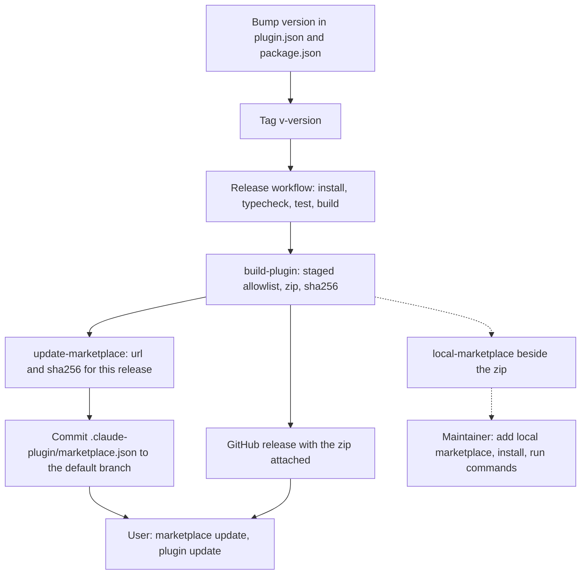

# Claude Plugin Distribution - Plan

## Goal Capsule

- **Objective:** A person who has never seen this repository can install the subzero plugin from a public marketplace and, following only the README, get a compound-engineering subagent running on a model they chose.
- **Means:** a built, plugin-only zip attached to each tagged release and a marketplace named `qoherent` that points at it (KTD1, KTD3), tested locally before the repository moves to `qoherent/sub0` (KTD2).
- **Product authority:** the Product Contract below. The R-IDs win on behavior; KTDs win on mechanism.
- **Execution profile:** Standard, seven units (U1 to U7). TypeScript and Node scripts, vitest, a GitHub Actions workflow, and the `design/*.sigil` files updated with the code they describe.
- **Stop conditions:** stop and ask if Claude Code does not keep the executable bit of `bin/subzero` through an archive install and the fallback in KTD6 also fails, or if the release workflow cannot push to the default branch and no pull-request route is acceptable (KTD5).
- **Who finishes:** `ce-work` implements U1 to U6. U7 needs a person with Claude Code: its first stage runs now against a local marketplace, and its second runs once the repository is at `qoherent/sub0` and a tag has been pushed.

---

## Product Contract

Product Contract preservation: changed. R1 now names the marketplace (`qoherent`) and the repository it lives in after the move (`qoherent/sub0`), and R12 is new: a written post-transfer checklist and a way to test locally before the move. Both follow the user's direction in this session. Two wording clarifications came from document review and change no intent: R7 no longer lists the agent file among the prerequisites that print a message, which its own last clause and AE4 already said, and R2 says plugin contents reach users only through release zips and that the catalog file on the default branch changes only in the release commit, which is what KTD5 does. R3 to R6 and R8 to R11 are unchanged, and the Outstanding Questions that research answered are now KTDs.

### Summary

Anyone adds a public GitHub marketplace named `qoherent`, installs a built subzero plugin from a per-release zip, and follows a README to get routing running. The plugin ships slash commands for its CLI actions, so users never type a path. Releases are tagged only and are labelled an experimental preview with the known limits stated.

### Problem Frame

Today the plugin only works from a development checkout. Its server and hooks live in `dist/`, which git ignores, so a plugin fetched from the repository would arrive without them. There is no marketplace file, the version is `0.0.1-spike`, the repository has no license, and the CLI (`subzero init`, `tasks`) is reachable only by the path of a built file. A stranger cannot install it, and a clone would not run.

### Key Decisions

- **Public, anyone.** The marketplace is open to any Claude Code user, with a public install page. Governs R1, R8. (session-settled: user-directed — chosen over a team-only marketplace, a few invited testers and a central directory listing: the user wants anyone to be able to install it.)
- **Experimental preview.** The first release claims no compatibility promise and states its known limits. Governs R3, R9. (session-settled: user-directed — chosen over a stable 0.1.0 and keeping the spike label: the spike's go/no-go decision is still open and the limits are real.)
- **Tagged releases only.** Users receive a new version only when a release is cut; changes on the main branch never reach them. Governs R2, R10, R11. (session-settled: user-directed — chosen over tracking main and over separate stable and preview channels: main stays free to be unstable.)
- **The release zip is the delivery mechanism.** Each release attaches a built, plugin-only zip, and the marketplace entry points at it. Governs R2, R4. (session-settled: user-directed — chosen over a built tag in the repository, which the agent recommended, and over an npm package: a clean install without repository history, at the cost of updating the entry per release.)
- **First run is README steps.** Setting up pi and a model stays the user's job. Governs R7, R8. (session-settled: user-directed — chosen over a guided setup skill, automatic installation and a silent first-run text: no setup machinery in the preview.)
- **The plugin ships the commands.** Slash commands run the bundled CLI, so there is no path to type and no second package. Governs R5. (session-settled: user-directed — chosen over an npm package and over a path in the README: users stay inside Claude Code.)
- **Apache-2.0.** The public repository and the zip carry the Apache-2.0 license. Governs R6. (session-settled: user-directed — chosen over MIT and over deciding at release time: it is the license the user wants on the code.)
- **The marketplace is named `qoherent`.** The plugin keeps the name `subzero`, so users install `subzero@qoherent`. Governs R1, R8. (session-settled: user-directed — chosen over a marketplace named `subzero` (`subzero@subzero`): the marketplace belongs to the organization, not to one plugin.)
- **The repository moves to `qoherent/sub0`; test locally first.** The final URLs are `qoherent/sub0`, but the work must be testable before the move, and what to do after it is written down. Governs R1, R12. (session-settled: user-directed — chosen over waiting for the transfer before testing anything: the move is not yet done.)
- **Done means a newcomer's walkthrough.** The distribution is accepted when someone who has never seen the repository follows only the README and reaches a routed subagent. Governs the Success Criteria. (session-settled: user-directed — chosen over an automated release check and over a clean-machine install by the maintainer: the README is the product's front door.)

### Requirements

**Marketplace and install**

- R1. A public GitHub repository, `qoherent/sub0` after the transfer, hosts a marketplace named `qoherent` that lists the subzero plugin, so a user installs it with Claude Code's standard marketplace-add and plugin-install commands.
- R2. Each release is a tagged version with a built plugin zip attached, and the marketplace entry delivers that release's zip; plugin contents reach users only through release zips, and the catalog file on the default branch changes only in the release's own commit.
- R3. A release's version label marks it as a preview and is the same in the plugin manifest, the tag and the zip name.

**Plugin contents**

- R4. The zip holds only what the plugin needs to run (the built server and hooks, the manifest, the MCP and hook configuration, the skills and commands, the license) and none of the source, tests, benchmarks, examples or design files; it needs no install step beyond Node and pi.
- R5. The plugin ships slash commands for the CLI actions a user needs from inside Claude Code (at least `init` and `tasks`); each runs the bundled CLI with no path typed by the user.
- R6. The repository and the zip carry an Apache-2.0 license.

**First run and docs**

- R7. A missing prerequisite (Node 22 or later, or pi on the path) gives a plain message that names what to do. The plugin installs nothing and edits neither the user's pi configuration nor any other file on its own; a project with no agent file gets no message, no routing and no routing text.
- R8. The README gives the path from nothing to a routed subagent in order: prerequisites, adding the marketplace and installing, running `init` with a model, confirming with a test delegation, and updating.
- R9. The install page states that this is an experimental preview and lists the known limits: plan mode is not respected, pi is the only child host, the general agent can write files and run shell commands inside pi outside Claude Code's permission prompts, and the queue is per session.

**Releasing**

- R10. A user receives a new release by updating the marketplace and the plugin; the install page says how.
- R11. A maintainer can cut a release from a tag, and the steps that produce the zip and update the marketplace entry are written down.
- R12. The repository carries a written checklist of what to do after the transfer to `qoherent/sub0`, and a way to test the plugin and a local marketplace before the transfer.

### Key Flows

- F1. First install and first routed subagent
  - **Trigger:** A Claude Code user with Node 22 and pi finds the project's README.
  - **Steps:** adds the marketplace and installs the plugin; runs the `init` command with a model; starts a compound-engineering review; sees a mid-tier subagent run as a subzero task.
  - **Outcome:** a routed subagent runs on the user's chosen model.
  - **Covered by:** R1, R5, R7, R8

### Acceptance Examples

- AE1. A newcomer follows only the README
  - **Covers R1, R5, R8.**
  - **Given** a machine with Claude Code, Node 22 and pi, and no copy of the repository.
  - **When** the person follows only the README.
  - **Then** the plugin installs, `init` writes an agent file, and a delegated test task completes.
- AE2. A prerequisite is missing
  - **Covers R7.**
  - **Given** a machine where pi is not installed.
  - **When** the user runs the `init` command.
  - **Then** it says that pi is missing and what to install, changes nothing, and installs nothing.
- AE3. Main changes between releases
  - **Covers R2.**
  - **Given** a user on release N and an unreleased change on the main branch.
  - **When** the user updates the plugin.
  - **Then** the user still has release N until release N+1 is tagged and the marketplace entry points at it.
- AE4. A project with no agent file
  - **Covers R7.**
  - **Given** the plugin is installed and a project has no `.agents/subzero.yaml`.
  - **When** a session starts and compound-engineering dispatches a subagent.
  - **Then** no routing text is added and the subagent runs on Claude as it does today.
- AE5. Testing before the transfer
  - **Covers R12.**
  - **Given** the repository is not yet at `qoherent/sub0` and no release exists.
  - **When** a maintainer follows the local-testing steps.
  - **Then** the plugin installs from a marketplace on the maintainer's machine, its commands and hooks run, and the steps that need the final URLs are listed for after the transfer.

### Success Criteria

- A person who has never seen the repository follows only the README and reaches a routed subagent, without cloning anything.

### Scope Boundaries

**Deferred for later**

- A guided `/subzero:setup`, automatic installation of pi, and a silent first-run text.
- A preview channel beside the stable one.
- An npm package, and with it a command-line tool usable outside Claude Code.
- A listing in Anthropic's or any central plugin directory.
- An automated release check that installs the zip into a scratch profile.
- Other parents and child hosts: Codex or pi as the parent, and any child other than pi.
- Slash commands for `show` and `attach`: `attach` follows a live child and suits a terminal, and `show` opens an exported page.

**Outside this work**

- Changing how routing behaves; this work packages what exists. The known limits go on the install page and are not fixed here.

### Dependencies / Assumptions

- The plugin runs from `dist/*.js`, which `.gitignore` excludes, and the existing build bundles each entry with no install step. Checked in this repository.
- After the transfer, `qoherent/sub0` and its release downloads are public, so an anonymous install can fetch the zip. Before the transfer nothing in this plan needs the final URLs.
- Users have Node 22 or later and pi with a model of their own; the plugin does not provide them.

### Outstanding Questions

**Resolve Before Planning**

- None.

**Deferred to Planning**

- The lowest Claude Code version that installs an `archive` plugin: the documentation gives none for this source, and the work was tested on 2.1.318 (carried to Assumptions in the Planning Contract).

**Needs the user's answer before the README text (U6) is final**

- Does R9 gain a fifth known limit, "the project's `.agents/subzero.yaml` is executable-grade configuration, so use routing only in repositories you trust"? A repository you clone can set the agent's tools, skills and model tiers and switch the routing hook on. The recommendation is to add the limit; making the hooks require a user-level opt-in instead would change routing behavior, which is outside this work.

### Sources / Research

- `.gitignore` (excludes `dist/`), `.claude-plugin/plugin.json` (version `0.0.1-spike`), `.mcp.json` and `hooks/hooks.json` (run `dist/server.js`, `dist/hook.js`, `dist/agent-hook.js`), `build.mjs` (bundles each entry).
- `docs/target-claude-pi.md` §2 (install through `claude plugin install subzero@<marketplace>`; `--plugin-dir` for development) and `docs/problem.md` ("not a marketplace" for skills, unrelated to plugin distribution).
- `examples/demo/README.md` (the known limits an install page must repeat).

---

## Planning Contract

### Key Technical Decisions

- KTD1. **A release is a zip fetched through an `archive` source.** The marketplace entry carries the zip's `url` and `sha256` and no `version`; `version` lives only in the manifest inside the zip. Claude Code takes a manifest `version` over an entry `version`, and a version set in both is a warning when they differ, so one owner avoids the mismatch. Claude Code detects an update by comparing computed versions, so each release must change the manifest version. Governs R2, R3.
- KTD2. **One source for the repository slug.** `package.json` `repository` names the GitHub repository (`qoherent/sub0` after the move); the zip URL, the marketplace entry and the manifest's `repository` and `homepage` are derived from it by the scripts, never typed twice. The transfer is then a one-line change plus the checklist in R12. Governs R1, R12.
- KTD3. **The committed manifest owns the version.** `.claude-plugin/plugin.json` and `package.json` carry the same version string (`0.1.0-preview.1` for the first release), a release is a version-bump commit plus a tag `v<version>`, and the build script refuses to run when the two files, or the tag, disagree. Governs R3, R11.
- KTD4. **The zip is built from an allowlist, not a denylist.** `scripts/build-plugin.mjs` copies named paths into a staging directory (the manifest, `.mcp.json`, `hooks/hooks.json`, the shipped skills, `bin/subzero`, the four `dist/*.js` bundles, `LICENSE`, and a generated minimal `package.json` of `{"type":"module"}` so Node reads the ESM bundles as modules on every Node 22 release) and zips the directory with the plugin at the zip root. A new file never ships by accident, and the demo `review` skill, source, tests, benchmarks, examples and designs stay out. Governs R4.
- KTD5. **A tag-triggered workflow cuts the release and commits the marketplace entry.** On a `v*` tag, GitHub Actions runs two jobs. The build job has `contents: read`, fails unless the tagged commit is an ancestor of the default branch, installs with `npm ci` against the lockfile, type-checks, tests and builds, builds the zip with the tag check, and uploads the zip as a workflow artifact. The release job has `contents: write`, runs no project code beyond `scripts/update-marketplace.mjs`, downloads that artifact, creates the release (a prerelease while the version has a `-preview` label) with the zip attached, and commits `.claude-plugin/marketplace.json` to the default branch. Third-party actions are pinned to commit SHAs. The write token therefore never runs dependency code, and a tag on an unmerged branch cannot publish. The file is generated, so it does not exist before the first release. If the default branch refuses the commit, the fallback is a pull request opened by the workflow (decided when it first fails, not now). Governs R2, R11.
- KTD6. **Commands are skills that call the shim by path.** `skills/init/SKILL.md` and `skills/tasks/SKILL.md` carry `disable-model-invocation: true` and an `allowed-tools` entry for the shim, and tell Claude to run `SUBZERO_PROJECT_DIR="${CLAUDE_PROJECT_DIR}" sh "${CLAUDE_PLUGIN_ROOT}/bin/subzero" <command> ...` and report its output unchanged, so a shell that has changed directory cannot move the project root. Calling the shim through `sh` by path does not depend on the executable bit surviving the archive or on `bin/` being on `PATH`; `bin/subzero` also puts a bare `subzero` on Claude's Bash `PATH`. Governs R5.
- KTD7. **The shim is a small POSIX script and the one launcher.** `bin/subzero` finds the plugin root from its own location, checks that `node` exists and is version 22 or later and otherwise prints one plain line naming what to install, then runs `dist/cli.js` with the arguments. Its `--bundle server` and `--bundle hook` or `agent-hook` modes run `dist/server.js`, `dist/hook.js` or `dist/agent-hook.js` the same way, and `.mcp.json` and `hooks/hooks.json` launch through it, so a user without Node gets the plain message from the MCP server and the hooks as well as the commands. A failed check exits non-zero for the CLI and the server, and exits 0 for the hooks so they still fail open. The shim also exports `CLAUDE_PROJECT_DIR` as `SUBZERO_PROJECT_DIR` when the latter is unset. Windows is out of scope for the preview. Governs R5, R7.
- KTD8. **The pi prerequisite check is a driver capability reached through the Kernel.** `ChildDriver` gains an optional `prerequisites` check, `Kernel` exposes it per host, `PiDriver` implements it by running `pi --version`, and `subzero init` calls it before it writes anything and stops with the driver's message when it fails. The core names no host, as the Kernel design requires, and the four designs (`kernel`, `pi-driver`, `task-core`, `cli`) are updated with the code. Governs R7.
- KTD9. **Local testing builds a marketplace beside the zip.** `scripts/build-plugin.mjs` also writes `dist-release/local-marketplace/` with a `qoherent` marketplace whose one entry is a relative path to a copy of the staged plugin. Claude Code reads relative-path plugins of a locally added marketplace in place, so this exercises the manifest, commands, hooks and MCP server before any URL exists; only the `archive` fetch is left for after the transfer. Governs R12.

### Assumptions

- Claude Code 2.1.318 is the version this was tested on. The documentation gives no minimum for `archive` sources, so the README says "a current Claude Code" and U7 records the version used.
- Maintainers have `zip` available (the CI runner and macOS both do); the build script reports a missing `zip` plainly.
- The marketplace name `qoherent` is not on Claude Code's reserved list (checked against the reserved-names section of the marketplace reference).

### High-Level Technical Design

The release pipeline, from a version bump to a user's update. The solid path runs after the transfer; the dashed path is how a maintainer tests before it.



### Output Structure

```text
bin/subzero                           shim: Node check, runs dist/cli.js
skills/init/SKILL.md                  /subzero:init
skills/tasks/SKILL.md                 /subzero:tasks
scripts/build-plugin.mjs              staged plugin, zip, sha256, local marketplace
scripts/update-marketplace.mjs        marketplace.json for one release
.github/workflows/release.yml         tag-triggered release
LICENSE                               Apache-2.0
README.md                             install page
docs/releasing.md                     local testing, release steps, after the transfer
docs/distribution-results.md          U7 results
```

### System-Wide Impact

- **The hooks run in every project of every user who installs the plugin.** The SessionStart and PreToolUse hooks fire on each session and each Agent call; both do nothing without an agent file and fail open, and each spawn costs one short Node process. The README says so (U6).
- **A marketplace install has its own data folder.** `${CLAUDE_PLUGIN_DATA}` becomes `subzero-qoherent` for a marketplace install, separate from the `subzero-inline` folder a `--plugin-dir` run uses, so deny memory and session files do not carry over from development.
- **A development `--plugin-dir` copy shadows an installed one.** Claude Code loads a same-named inline plugin over a marketplace plugin; U7 starts its local stage without `--plugin-dir`.

### Risks

| Risk | Mitigation |
|---|---|
| Claude Code drops the executable bit of `bin/subzero` when it extracts the zip. | The commands call the shim through `sh` by path (KTD6); only the bare `subzero` on `PATH` would be lost, and U7 checks it. |
| The release workflow cannot push the marketplace commit to a protected default branch. | The first run shows it; the fallback is a workflow-opened pull request (KTD5), and the checklist lists the repository setting to check. |
| The `archive` update path behaves differently from the documented version rule. | U7's second stage cuts a second preview and updates from the first; AE3 is the check. |
| Design drift: every `src/**` file implements a `design/*.sigil` component and U3 changes four of them. | U3 updates the four designs with the code and the verification gate runs `sigilc` and the `sigil-align` skill over them. |
| A zip that ships something it should not, such as a local agent file or a build cache. | Allowlist build (KTD4) plus a test that pins the exact file set. |
| The repository is private after the transfer, so an anonymous download fails. | The checklist asks for a public repository and public releases before the first tag; U7's second stage installs from a clean profile. |
| `${CLAUDE_PLUGIN_ROOT}` is not substituted inside a skill's `allowed-tools`, so each command shows one permission prompt. | U7 stage 1 observes it; the commands still work and the README names the prompt. The substitution itself is not documented for that field. |
| Anyone who can change `.claude-plugin/marketplace.json` on the default branch redirects every installer to other code, and the `sha256` only guards the release asset. | The checklist (U6) sets branch protection and a required review on that file, and tag protection for `v*`. |
| Publishing the repository exposes spike artifacts and history irreversibly. | The checklist (U6) scans the tracked files and the history before the repository is made public. |

---

## Implementation Units

### U1. License and version metadata

**Goal:** Put the license and the preview version on the repository and the manifest.

**Requirements:** R3, R6; KTD2, KTD3.

**Dependencies:** none.

**Files:**
- `LICENSE` (new; the Apache-2.0 text)
- `.claude-plugin/plugin.json`
- `package.json`
- `test/release/manifest.test.ts` (new)

**Approach:**
1. Add the standard Apache-2.0 text as `LICENSE`.
2. Set `version` to `0.1.0-preview.1` in `.claude-plugin/plugin.json` and `package.json`, add `license: Apache-2.0` to both, and set `package.json` `repository` to the GitHub URL of `qoherent/sub0` (KTD2). Add `author` and `keywords` to the manifest where the plugin manifest reference lists them; the manifest's `repository` and `homepage` are written by the build from `package.json` (U4), not by hand.
3. Leave `private: true` in `package.json`: nothing is published to npm.

**Patterns to follow:** `test/wiring/wiring.test.ts` for tests that read the repository's own files.

**Test scenarios:**
- The version string in `.claude-plugin/plugin.json` equals the one in `package.json`.
- The version carries a `-preview` label, so a stable version cannot ship by accident.
- Both files name the license `Apache-2.0`, and `LICENSE` starts with the Apache License, Version 2.0 title.
- `package.json` `repository` parses to the slug `qoherent/sub0`.

**Verification:** the manifest tests pass and `claude plugin validate .` reports no error for the manifest.

### U2. Plugin commands and the shim

**Goal:** A user types `/subzero:init` or `/subzero:tasks` inside Claude Code and the bundled CLI runs, with a plain message when Node is missing or too old.

**Requirements:** R5, R7; KTD6, KTD7.

**Dependencies:** none.

**Files:**
- `bin/subzero` (new, executable)
- `skills/init/SKILL.md` (new)
- `skills/tasks/SKILL.md` (new)
- `.mcp.json`, `hooks/hooks.json` (launch through the shim)
- `test/release/shim.test.ts` (new), `test/wiring/wiring.test.ts` (if it reads the launch commands)

**Approach:**
1. Write the POSIX shim: resolve the plugin root from the script's own path, check `node` and its major version, print one line when it fails (exit non-zero, or 0 in the hook modes), forward `CLAUDE_PROJECT_DIR` as `SUBZERO_PROJECT_DIR` when the latter is unset, and otherwise `exec node` on `dist/cli.js` or, for `--bundle <name>`, on that bundle (KTD7).
2. Change `.mcp.json` and `hooks/hooks.json` to launch the server and the two hooks through `sh "${CLAUDE_PLUGIN_ROOT}/bin/subzero" --bundle ...`, keeping the existing environment variables and matchers.
3. Write the two skills as user-invoked commands: an `argument-hint`, `disable-model-invocation: true`, an `allowed-tools` entry for the shim, and a body that tells Claude to run the shim by path with `SUBZERO_PROJECT_DIR` set from `${CLAUDE_PROJECT_DIR}` (KTD6) and to show its output without editing files itself. The `init` body passes the model argument through and names the optional `--host`, `--timeout` and `--thinking`.
4. Do not touch `skills/review/SKILL.md`; it is the demo skill and the build leaves it out (KTD4).

**Patterns to follow:** `skills/review/SKILL.md` for the frontmatter and tone of a plugin skill.

**Execution note:** The shim and the commands are packaging; prefer a real shim run with a stub `node` and a headless Claude Code run over unit coverage of the skill text. Whether `${CLAUDE_PLUGIN_ROOT}` is substituted inside `allowed-tools` is not documented; if it is not, drop that entry and accept one permission prompt per command (see Risks).

**Test scenarios:**
- With a stub `node` on `PATH` that reports version 22 or later, the shim passes its arguments to `dist/cli.js` and returns its exit status.
- With a stub `node` that reports version 20, the shim prints one line naming Node 22 and exits non-zero without running the CLI.
- With no `node` on `PATH`, the shim prints one line naming Node and exits non-zero.
- The shim finds the plugin root when called through a symlink or from another directory.
- With `CLAUDE_PROJECT_DIR` set and `SUBZERO_PROJECT_DIR` unset, the CLI the shim runs sees the project root from `CLAUDE_PROJECT_DIR`; an existing `SUBZERO_PROJECT_DIR` is left alone.
- `--bundle server` runs `dist/server.js` and `--bundle hook` runs `dist/hook.js` with the arguments of the caller; with no suitable `node`, a hook mode prints the Node line and exits 0, and the server mode exits non-zero.
- `.mcp.json` and `hooks/hooks.json` launch each bundle through `bin/subzero`, with the same `SUBZERO_PROJECT_DIR` and `SUBZERO_DATA` variables and the same hook matchers as before.
- Both skills carry `disable-model-invocation: true`, and each body refers to `${CLAUDE_PLUGIN_ROOT}/bin/subzero`.

**Verification:** the shim tests pass, `npm test` still passes with the new launch commands, and `claude plugin validate .` on the repository root reports no error for the two skills and the changed configuration.

### U3. Prerequisite check through the child driver

**Goal:** `subzero init` says that pi is missing, and what to do, before it writes anything.

**Requirements:** R7; KTD8; covers AE2.

**Dependencies:** none.

**Files:**
- `src/core/types.ts` (the child driver shape gains an optional prerequisites check)
- `src/kernel/kernel.ts` (a lookup by host)
- `src/pi/driver.ts` (runs `pi --version`)
- `src/cli/cli.ts` (`init` calls the check)
- `design/kernel.sigil`, `design/pi-driver.sigil`, `design/task-core.sigil`, `design/cli.sigil`
- `test/kernel/kernel.test.ts`, `test/pi/driver.test.ts`, `test/cli/cli.test.ts`

**Approach:**
1. Add the optional check to the child driver shape, return a pass or a message from it, and expose it from the Kernel by host with the same unsupported-host error as the other lookups.
2. Implement it in `PiDriver` by running the configured pi command with `--version`, and word the failure to name pi, say it was not found or did not run, and say to install it and run `init` again.
3. Have `init` run the check for the chosen host before the agent-file write, stop with the driver's message and a non-zero exit, and leave every file unchanged; a driver with no check lets `init` continue as today.
4. Update the four designs with the new commitments, keeping them under the Sigil prose limit.

**Patterns to follow:** the starter-tools lookup in `src/kernel/kernel.ts` and `src/pi/driver.ts`, and the `init` refusal cases in `test/cli/cli.test.ts`.

**Execution note:** Start with a failing CLI test for the pi-missing case against a fake pi command that does not exist.

**Test scenarios:**
- Covers AE2. With a pi command that does not exist, `init` exits non-zero with a message that names pi, and no agent file is written.
- With a pi command that exits non-zero, `init` fails the same way.
- With the fake pi from `test/fake-pi/fake-pi.mjs`, the check passes and `init` writes the starter entries as before.
- A driver that offers no check lets `init` continue, and an unsupported host still gets its existing error.
- The Kernel returns the check of the registered driver and the unsupported-host error for an unknown host.

**Verification:** the three test files pass, `sigilc tree --root .` reports no diagnostics, and the `sigil-align` skill reports Kernel, PiDriver, TaskCore and Cli aligned.

### U4. Release build: zip, checksum and local marketplace

**Goal:** One command builds the plugin-only zip with its checksum and a local marketplace for testing.

**Requirements:** R2, R3, R4, R12; KTD3, KTD4, KTD9.

**Dependencies:** U1, U2.

**Files:**
- `scripts/build-plugin.mjs` (new)
- `package.json` (adds a `release:build` script)
- `.gitignore` (adds `dist-release/`)
- `test/release/build-plugin.test.ts` (new)

**Approach:**
1. Read the version from the manifest and refuse when it differs from `package.json` or from a `--tag` argument that is not `v<version>` (KTD3). The preview label itself is guarded by the U1 test, not here.
2. Copy the allowlist (KTD4) into `dist-release/subzero-<version>/`, write its minimal `package.json`, set the staged manifest's `repository` and `homepage` from `package.json` `repository` (KTD2), keep the executable bit on `bin/subzero`, and zip it with the plugin at the zip root into `dist-release/subzero-<version>.zip`.
3. Write the zip's `sha256` next to it and print the zip path, the checksum and the version as one JSON line for the workflow.
4. Write `dist-release/local-marketplace/` with a `qoherent` marketplace whose entry is a relative path to a copy of the staged plugin (KTD9).
5. Fail with a plain message when `dist/` is missing or `zip` is not installed.

**Patterns to follow:** `build.mjs` for script style, and the temporary-directory helpers in `test/helpers.ts`.

**Test scenarios:**
- The staged directory holds exactly the allowlist, including a `package.json` whose only fields make the bundles ES modules, and no `src`, `test`, `bench`, `examples`, `design`, `docs`, `node_modules`, `.agents` or `skills/review`.
- `bin/subzero` is executable in the staged directory, and the zip lists the same files as the staged directory.
- The printed checksum equals the zip's SHA-256 computed independently.
- The staged manifest's `repository` and `homepage` follow `package.json` `repository`: changing the slug there changes both, and the committed manifest is not edited.
- A manifest version that differs from `package.json` exits non-zero and builds nothing.
- `--tag v0.1.0-preview.1` with that version passes, and `--tag v0.1.0-preview.2` exits non-zero.
- The local marketplace file names `qoherent`, has one entry named `subzero` with a relative source, and its staged plugin passes `claude plugin validate` when Claude Code is available.
- A missing `dist/` exits non-zero with a message that says to run the build first.
- Covers R4. Running the staged `dist/cli.js` through `bin/subzero` from the staged directory, with no repository around it, prints the CLI's usage and exits cleanly.

**Verification:** the build tests pass, and `claude plugin validate dist-release/local-marketplace` ends with `Validation passed`.

### U5. Marketplace entry and release workflow

**Goal:** Pushing a version tag produces a release with the zip and a marketplace entry that points at it.

**Requirements:** R1, R2, R11; KTD1, KTD2, KTD5.

**Dependencies:** U4.

**Files:**
- `scripts/update-marketplace.mjs` (new)
- `.github/workflows/release.yml` (new)
- `.claude-plugin/marketplace.json` (generated by the script on the first release; not committed before)
- `test/release/update-marketplace.test.ts` (new), `test/release/workflow.test.ts` (new)

**Approach:**
1. Write the script to read the repository slug (KTD2), the version and the checksum, and write `.claude-plugin/marketplace.json`: name `qoherent`, an owner, a description, and one entry named `subzero` with an `archive` source whose `url` is the release asset URL for that tag and whose `sha256` is the checksum, and no `version` (KTD1).
2. Make it idempotent: running it twice for one release changes nothing, and a later release replaces the entry's `url` and `sha256`.
3. Write the workflow per KTD5: a read-only build job (ancestor-of-default-branch check, Node 22, `npm ci`, the tag check on the build, artifact upload) and a write job (artifact download, `gh release create` marked a prerelease for a `-preview` version, the marketplace script, and a commit of the marketplace file to the default branch by the workflow's own identity), with third-party actions pinned to commit SHAs.

**Patterns to follow:** the `yaml` package already in the dependencies, for reading the workflow in tests.

**Test scenarios:**
- The generated file names the marketplace `qoherent` and the plugin `subzero`, has an `archive` source with an `https` URL under `https://github.com/qoherent/sub0/releases/download/v<version>/`, a 64-character `sha256`, and no `version` key.
- Changing `package.json` `repository` changes the URL and nothing else.
- Running the script twice with the same inputs leaves the file byte-identical, and a second release replaces the first release's `url` and `sha256`.
- A checksum that is not 64 hexadecimal characters exits non-zero.
- The workflow triggers on tags matching `v*`. Its build job has `contents: read`, runs `npm ci` and the build with the tag, and uploads the zip; its release job has `contents: write`, needs the build job, downloads the artifact and runs no `npm` command.
- Every `uses:` of a third-party action in the workflow is pinned to a 40-character commit SHA.
- The build job contains a step that fails when the tagged commit is not an ancestor of the default branch.

**Verification:** the two test files pass, and `claude plugin validate .` on a checkout with a generated marketplace file reports no error.

### U6. README and releasing guide

**Goal:** The install page a newcomer follows, and the maintainer's guide with local testing, release steps and the after-the-transfer checklist.

**Requirements:** R8, R9, R10, R11, R12; covers AE5.

**Dependencies:** U2, U4, U5.

**Files:**
- `README.md` (new)
- `docs/releasing.md` (new)
- `test/release/docs.test.ts` (new)

**Approach:**
1. Write the README in the order R8 gives: what it is, the preview notice and known limits (R9's four, plus the limits the demo README records: if the server fails to start the session text still says routing is on while every subagent runs on Claude, and worktree and fork spawns always stay on Claude; plus the hook that runs on every Agent call, and the answer to the open question on agent-file trust), prerequisites (Node 22, pi with a model, a current Claude Code, macOS or Linux, since Windows is not supported in this preview), `/plugin marketplace add qoherent/sub0`, `/plugin install subzero@qoherent`, `/subzero:init <model>`, a test delegation, updating (R10), and the license.
2. Write `docs/releasing.md` with three parts: local testing before the transfer (build, add `dist-release/local-marketplace`, install, run the commands, remove it afterwards), cutting a release (bump the version in both files, merge, tag, what the workflow does, what to check), and **After the transfer to `qoherent/sub0`** (R12), listing:
   - transfer the repository, then update the local remote;
   - scan the tracked files and the full history for credentials, local paths and private endpoints (the benchmark results under `bench/` record local paths and model names) and remove or move what should not be public, before anything is made public;
   - make the repository and its releases public, enable Actions, give workflows write permission, and let the default branch accept the release commit or choose the pull-request route (KTD5);
   - protect the `v*` tags, and protect the default branch with a required review on `.claude-plugin/marketplace.json`, since that file decides what every installer downloads;
   - confirm `package.json` `repository` names `qoherent/sub0` and search the docs and the demo for the old owner and name;
   - confirm the marketplace name `qoherent` is free and run `claude plugin validate .`;
   - push the first tag and check the release, the zip and the committed marketplace file;
   - install from a clean profile with the README commands, run `init` and a routed task, and record the result in `docs/distribution-results.md`;
   - cut a second preview and update from the first to verify AE3.
3. Keep both pages repo-relative where they point inside the repository.

**Patterns to follow:** `examples/demo/README.md` for tone and for how it states the known limits.

**Test scenarios:**
- The README contains the two install commands exactly as step 1 of this unit's Approach gives them, the `init` command, and each of R9's four known limits and the two demo-README limits.
- The README names Node 22, pi, a model and macOS or Linux as prerequisites, and says Windows is not supported.
- `docs/releasing.md` has a section titled "After the transfer to qoherent/sub0" and each checklist item above appears in it, including the pre-publication scan and the tag and branch protection.
- Neither page contains the old owner and name outside the section that tells a maintainer to search for them.

**Verification:** `test/release/docs.test.ts` passes and the two pages read in order without a missing step.

### U7. Acceptance walkthroughs

**Goal:** Show that a newcomer reaches a routed subagent, first against the local marketplace now and then against the real release after the transfer.

**Requirements:** the Success Criteria; AE1, AE3, AE5.

**Dependencies:** U6.

**Files:**
- `docs/distribution-results.md` (new)

**Approach:**
1. **Stage 1, before the transfer.** Build with `release:build`, add `dist-release/local-marketplace` to a clean Claude Code profile (no `--plugin-dir`), install `subzero@qoherent`, and run `/subzero:init` and `/subzero:tasks` against a throwaway project and a reachable model. Record that the MCP server connects, the commands run, a routed subagent completes, and `bin/subzero` runs bare. Headless `claude -p` runs may do this.
2. **Stage 2, after the transfer and the first tag.** A person who has not seen the repository follows only the README on a clean profile: add `qoherent/sub0`, install, `init`, a routed task. Then cut a second preview and update from the first.
3. Record each result, the Claude Code version and any failure in `docs/distribution-results.md`, and note which criteria are met.

**Execution note:** This is a live smoke run; prove each step from Claude Code's own output and the subzero task records, not from the README alone.

**Test scenarios:**
- Covers AE5. Stage 1 installs from the local marketplace and the two commands run with no path typed.
- Covers AE1. Stage 2 reaches a completed routed task from the README alone.
- Covers AE3. After the second preview is tagged, `claude plugin update subzero@qoherent` moves the install to it, and an unreleased change on the default branch did not reach the user before that.
- Covers AE4. In a throwaway project with no `.agents/subzero.yaml`, a session start adds no routing text and a dispatched subagent runs on Claude.
- With `pi` absent from `PATH`, `/subzero:init` prints the prerequisite message and writes no agent file (AE2, live).
- With Node 20 first on `PATH`, `bin/subzero` prints the Node message.

**Verification:** `docs/distribution-results.md` records each stage, with the evidence for each criterion and anything that failed.

---

## Verification Contract

| Gate | Command or check | Applies to |
|---|---|---|
| Types | `npm run typecheck` | every unit |
| Unit tests | `npm test` (vitest, fake pi) | U1 to U6 |
| Build | `npm run build`, then `npm run release:build` | U4, U5, U7 |
| Plugin and marketplace validation | `claude plugin validate` on the staged plugin, on `dist-release/local-marketplace`, and on the repository root once a marketplace file exists | U1, U2, U4, U5 |
| Design conformance | `sigilc tree --root .` with no diagnostics, and the `sigil-align` skill over Kernel, PiDriver, TaskCore and Cli | U3 |
| Acceptance | the U7 stages, each recorded in `docs/distribution-results.md` | U7 |

## Definition of Done

- Every R-ID is implemented and covered by a U1 to U6 test scenario or the U7 stages; R12 is covered by U4, U6 and U7 stage 1.
- `npm run typecheck`, `npm test` and `npm run build` pass, and `npm run release:build` produces the zip, its checksum and a local marketplace that passes `claude plugin validate`.
- The staged plugin holds exactly the allowlist of KTD4, with the executable bit on `bin/subzero`.
- The four designs match the code, and no file in the core names a particular child driver.
- `README.md` and `docs/releasing.md` exist, and the releasing guide's after-the-transfer section lists every step in U6.
- `docs/distribution-results.md` records U7 stage 1; stage 2 is recorded when the transfer and the first tag have happened, and until then the file says so.
- No code from abandoned approaches is left in the diff.
- Per unit: U1 done when the manifest tests pass; U2 when the shim runs with a stub `node` and the two skills validate; U3 when `init` stops on a missing pi with nothing written; U4 when the zip and local marketplace build and validate; U5 when the marketplace script and workflow tests pass; U6 when the docs tests pass; U7 when its stages are recorded.
